# COMP3710 Project: Multi-layer Graph Neural Network for Classifying Facebook Pages

## The Open Research Question
In web-scale graph classification, models frequently achieve deceptively high aggregate
test accuracy while concealing catastrophic overconfidence on borderline, ambiguous, 
or out-of-distribution cases. This can be problematic for automatic classification, as 
incorrect predictions may not be identified for further review because the model is 
extremely confident in its classification. The intended users who would benefit from
automatic classification are social network analysts seeking to reduce manual 
classification, so it is important that the model works effectively.

This project will investigate whether a multi-layer Graph Neural Network (GNN),
that is, a two-layer Graph Convolutional Network (GCN), can produce a more reliable 
confidence score than a Multi-Layer Perceptron (MLP) baseline when classifying facebook 
pages.

A confidence threshold will be investigated to determine whether uncertain predictions
can be sent for manual review, in order to reduce the risk of automatically accepting
incorrect classifications. The results will then be used to evaluate whether the
additional complexity of the GCN and computational costs justify its performance
when compared to the simpler MLP baseline.

## Background Research and GNN Model Selection
Graph-based classification can benefit from using both the features of individual nodes 
and the connections between them. Rozemberczki et al. [1] investigated attributed node 
embeddings, where information from a node and its neighbouring nodes is used to learn 
useful representations. By using information from neighbouring nodes (nodes that 
are connected through edges in the graph), their research investigated whether patterns in 
the surrounding network could provide additional information that improves node 
classification.

Rozemberczki et al. [1] evaluated several graph-based learning methods
using the Facebook Large Page-Page Network. Their results showed that a Graph 
Convolutional Network (GCN) achieved a test micro-F1 score of 0.932, compared with 0.919 
for a Graph Attention Network (GAT) and 0.941 for MixHop. Although MixHop achieved a 
higher score, the GCN was chosen for this project because it provides a simpler 
architecture while still demonstrating strong classification performance. This makes it 
suitable for investigating whether incorporating graph connections improves classification 
performance and confidence reliability when compared with an MLP baseline.

The setup used by the paper used a two-layer GCN with 32 hidden filters, the Adam 
optimiser, a learning rate of 0.01, 200 training epochs, an 80/20 training-test split, 
and dropout of 0.5. These parameter and training settings will be used as a good starting
point for the GCN model in this project, however a validation set is going to be used
as well as training and test to determine the best model.

The research primarily evaluates classification performance and does not investigate 
whether the models produce reliable confidence scores when their predictions are 
incorrect. This is the main area investigated in this project, where the GCN will be 
compared against an MLP baseline to determine whether incorporating graph connections 
improves classification performance and confidence reliability. A confidence threshold 
will also be evaluated to investigate whether uncertain predictions can be identified 
for manual review.

Feasability review is at bottom of report.

# Dependencies and Reproducability
## Software Dependencies and Versions
This project is implemented in Python using PyTorch and PyTorch Geometric.
PyTorch is used to implement and train the MLP and GCN models, while PyTorch 
Geometric provides the Facebook Page-Page dataset and the GCNConv layers used 
by the GCN.

Due to issues in the PyTorch Geometric dataset, the Facebook Page-Page dataset
was obtained from this link:

https://github.com/gayanku/facebook_page-page_dataset/tree/main

The libraries and their version used for this project are:
```
Python               3.10.12
PyTorch:             2.14.1+cu130
PyTorch Geometric:   2.8.0.post1
NumPy:               2.2.6
scikit-learn:        1.7.2
Matplotlib:          3.10.9
CUDA:                13.0
```
The project also uses standard Python libraries including argparse, csv and time. 
These are included with Python and do not require separate installation.

## Hardware and Computing Environment
The project was developed locally using Ubuntu through Windows Subsystem for Linux 
(WSL). A Python virtual environment named gnn_env was used to manage the project
dependencies.

Model training and evaluation can be performed using either a CPU or a CUDA-compatible
GPU. The training code automatically selects CUDA if available, otherwise uses the CPU.

## Project File Structure
The project is contained in the recognition/MultiLayer_GNN_s4801265/ directory and
consists of the five mandatory files:
- modules.py
- dataset.py
- train.py
- predict.py
- README.md

And these other two helper files:
- convert_dataset.py: Used for converting dataset to correct form
- inspect_node.py: Used for analysing failure case nodes

### Files Produced From Running Training
Training produces the following files for the GCN:
- gcn_best.pt
- gcn_predictions.csv 
- gcn_accuracy.png 
- gcn_confidence.png
- gcn_confusion_matrix.png
- gcn_loss.png 
- gcn_manual_review.png 
- gcn_reliability.png 
- gcn_tsne.png 

And the following for the MLP:
- mlp_best.pt
- mlp_predictions.csv
- mlp_accuracy.png 
- mlp_confidence.png 
- mlp_confusion_matrix.png
- mlp_loss.png 
- mlp_manual_review.png
- mlp_reliability.png

The code prints test accuracy, macro-F1, multiclass AUROC, per-class precision/recall, 
ECE, inference time, parameter count, GPU memory and failure-case information to the
terminal. When running on the Rangpur cluster these are saved in the resulting .out file.

## Dataset Installation and Conversion Instructions
The project requires Python 3.10 and the libraries listed in the Software 
Dependencies and Versions section.
A Python virtual environment can be created and activated using:
```bash
python3 -m venv ~/gnn_env
source ~/gnn_env/bin/activate
```
The required Python libraries can then be installed using pip:
```bash
python -m pip install torch
python -m pip install torch-geometric
python -m pip install numpy scikit-learn matplotlib
```
The Facebook Page-Page Network dataset was obtained from:

https://github.com/gayanku/facebook_page-page_dataset/tree/main

Here the dataset is called:
```bash
facebook.npz
```
The facebook.npz file must be downloaded and converted into the format expected by 
the PyTorch Geometric dataset loader before running the project. Here are the steps:
* Step 1: Create a folder called "raw" in the PatternAnalysis-2026/recognition/
MultiLayer_GNN_s4801265 directory and paste the downloaded "facebook.npz" file inside it
* Step 2: The downloaded dataset uses different array names from those expected by the 
PyTorch Geometric FacebookPagePage loader, so the dataset must first be converted using 
convert_dataset.py. Do this by running:
```bash
python convert_dataset.py
```
* Step 3: Dataset is now ready for training and can now be loaded by doing:
```bash
python dataset.py
```
NOTE: convert_dataset.py should only be run once, not every time the models are being 
trained or used for prediction.

## Reproducability and Random Seeds
A fixed random seed of 42 is used for dataset splitting, model initialisation and training 
to improve reproducibility. Both models use identical data splits and training settings to 
ensure a fair comparison. However, small differences in results may still occur across 
different hardware or software environments, particularly when using GPU operations.

## Running Training and Inference
### Training the Models
The training script can train both the MLP baseline and the two-layer GCN separately
using the --model argument.

To train the MLP:
```bash
python train.py --model mlp
```
To train the GCN:
```bash
python train.py --model gcn
```

To save the output when running do:
```bash
python train.py --model mlp 2>&1 | tee mlp_training.log
python train.py --model gcn 2>&1 | tee gcn_training.log
```

### Running Inference
The predict.py script is used to perform inference using an already trained MLP or GCN
model. It loads the saved model weights, uses the same dataset preprocessing and node 
splits as training, and predicts the class of the selected Facebook page nodes.

For each node, the script displays the predicted class, prediction confidence, 
probabilities for all four classes, the true class, and whether the prediction is 
correct.

The general command structure is:

```bash
python predict.py [--model {mlp,gcn}] [--node NODE_ID] [--num_samples N] [--threshold VALUE] [--checkpoint PATH]
```
All arguments are optional. The purpose of each argument is:
```
--model:       Selects trained model to use for inference
--node:        Specifies the index of particular node to classify
--num_samples: Specifies how many test nodes to display when --node is not provided
--threshold:   Specifies confidence threshold between 0 and 1 where predictions below
               this threshold are sent for manual review while equal and above are accepted
--checkpoint:  Specifies location of saved model weights if in another file
```
If no arguments are provided, the script uses the trained GCN model and displays 
predictions for the first five nodes in the test set.

Example commands:
```bash
# Using MLP
python predict.py --model mlp

# Classifying a specific node (can be any node in dataset)
python predict.py --model gcn --node 16052

# Classifying 10 test set nodes
python predict.py --model gcn --num_samples 10

# Indicate whether prediction is accepted or sent for manual review using a 0.56
# confidence threshold
python predict.py --model gcn --threshold 0.56

# Using a trained model in a different path
python predict.py --model gcn --checkpoint path/to/gcn_best.pt
```


# Dataset and Preprocessing
## Facebook Page-Page Network Dataset
This project uses the Facebook Large Page-Page Network dataset, which was collected
through the Facebook Graph API in November 2017. The dataset represents a network of
verified Facebook pages, where nodes represent official Facebook pages and edges 
represent mutual likes between pages [2].

The dataset contains four categories of Facebook pages: politicians, governmental
organisations, television shows and companies [2]. These categories were defined by 
Facebook, and the objective of this project is to classify each page into one of 
the four categories using its features and graph connections.

## Node Features, Graph Connections and Class Labels
Each Facebook page is represented by 128-dimensional node features extracted from
descriptions written by the page owners to summarise the purpose of their pages [2]. 
These features provide information about individual Facebook pages and are used 
by both the MLP and GCN during classification.

The graph connections represent mutual likes between Facebook pages. As these 
connections are undirected, the 171,002 edges are stored as 342,004 directed 
edge entries in PyTorch Geometric, representing connections in both directions. 
The dataset does not contain any edge features [3].

Each node has a class label represented by an integer from 0 to 3, corresponding 
to one of the four Facebook page categories. The meaning of each class number is given by:

| Class Number | Facebook Page Category |
|---|---|
| Class 0 | Television Shows |
| Class 1 | Governmental Organisations |
| Class 2 | Companies |
| Class 3 | Politicians |

The feature matrix has dimensions (22470, 128), the graph connections are stored in an 
edge_index tensor with dimensions (2, 342004), and the class labels have dimensions (22470).

The MLP uses only the node features, while the GCN uses both the features and graph 
connections.

## Dataset Statistics and Class Distribution
An initial dataset audit was performed using dataset.py to verify the graph dimensions,
class distribution and validity of the node features and labels. The dataset satistics
are given by:
| Property | Value |
|----------|-------|
| Number of nodes | 22,470 |
| Undirected edges | 171,002 |
| Directed edge entries | 342,004 |
| Features per node | 128 |
| Number of classes | 4 |
| Graph density | 0.001 |
| Graph transitivity | 0.232 |

Source [2] gave values for density and transitivity. The graph is not a Directed 
graph or a Temporal graph and there are no edge features.

The 22,470 nodes are distributed across four classes:
| Class | Number of Nodes | Percentage |
|-------|-----------------|------------|
| Class 0 | 6,495 | 28.91% |
| Class 1 | 6,880 | 30.62% |
| Class 2 | 5,768 | 25.67% |
| Class 3 | 3,327 | 14.81% |
| **Total** | **22,470** | **100.00%** |

From the class distribution is is seen there is some imbalance, with class 1
containing the most amount of nodes and class 3 containing the least. This is
important as a model may achieve high overall accuracy while performing poorly
on less common classes.

Because of this, classification performance will be evaluated using per-class 
precision and recall, macro-F1 and multiclass AUROC in addition to overall accuracy.

The graph density of approximately 0.001 indicates that relatively few connections exist
compared with the total number of possible connections. This indicates that the network 
is sparse, with each page connected to relatively few other pages compared to the total
number of pages. The transitivity of 0.232 indicates that some neighbouring pages form
interconnected groups, which may provide useful information for the GCN classification.

## Training, Validation and Test Splits
The dataset is divided into training, validation and testing sets using a 70/15/15 split.
The splitting procedure is divided by class, meaning that the nodes from each category
are divided separately to preserve approximately the same class distribution across the
three sets.

A 70/15/15 split was chosen instead of the 80/20 training-test split used in the 
original research because this project also requires a separate validation set. 
The validation set is used to select the best model checkpoint based on validation 
loss and determine a confidence threshold for manual review without using the test 
set. This is important because the project investigates confidence reliability, 
and using the test set to make these decisions could produce overly optimistic 
results. The 70/15/15 split provides sufficient data for training while keeping 
separate validation and test sets for model selection and final evaluation.

Using 15% test and 70% training gives 15% leftover for validation while being
really close to the original 80/20 split.

A fixed random seed of 42 is used to ensure that the splits can be reproduced. 
Both the MLP and GCN use the same splits to allow a fair comparison.

The resulting node counts for each split are given by:
| Class | Training | Validation | Test |
|-------|----------|------------|------|
| Class 0 | 4,546 | 974 | 975 |
| Class 1 | 4,816 | 1,032 | 1,032 |
| Class 2 | 4,037 | 865 | 866 |
| Class 3 | 2,328 | 499 | 500 |
| **Total** | **15,727** | **3,370** | **3,373** |

The training set is used to calculate the cross-entropy loss and update the model
parameters. The validation set is used to evaluate performance during training, 
select the checkpoint with the lowest validation loss and establish a confidence
threshold for manual review. The testing set is reserved for final evaluation.

Boolean masks named train_mask, val_mask and test_mask are used to identify the nodes 
belonging to each split. The dataset verification confirmed that no nodes belong 
to more than one split and that every node belongs to exactly one split.

## Feature Standardisation
The node features are standardised to ensure that differences in the scale of individual 
features do not affect the training of the models. Without standardisation, features with 
larger numerical values may have a greater influence on the model than features with 
smaller values, even if they are not more important for classification. Each of the 128 
features is standardised separately by subtracting its mean and dividing by its standard 
deviation, so that the training features have approximately zero mean and unit standard 
deviation.

The mean and standard deviation are calculated using only the training nodes and the same 
transformation is then applied to all nodes in the dataset. This is important because using 
statistics calculated from the validation or test nodes could introduce and leak 
information from these sets into preprocessing and affect the reliability of the 
evaluation. The same standardised node features are used by both the MLP and 
GCN to ensure a fair comparison.

## Data Leakage Prevention
This project uses transductive semi-supervised node classification, where the GCN uses the 
features and graph connections of all nodes, including validation and test nodes, but only 
training labels are used to update model parameters. During training, predictions are 
generated for all nodes, while the cross-entropy loss is calculated only for nodes 
identified by train_mask. This allows the GCN to learn from the complete graph structure 
without using validation or test labels during training.

Validation labels are used to select the best model checkpoint and confidence threshold, 
while test labels are reserved for final evaluation. This prevents test information from 
influencing model selection, which could otherwise produce overly optimistic results. 
The training, validation and test masks are also verified to be non-overlapping, 
and both models use identical splits to ensure a fair comparison.

# Model Implementation and Training
## Multi-Layer Perceptron (MLP) Baseline
The multi-layer perceptron is a neural network model which consists of multiple layers of
neurons. The model is made up of an input layer, hidden layer(s), and an output layer, 
where the neurons in the MLP typically use nonlinear activation functions, allowing the
network to learn complex nonlinear patterns in data. This type of neural network can be 
used to solve both classification and regression problems.

For this project the MLP was chosen as a baseline as it does not consider edge
connections between the nodes, only the node features themselves for classification.
This is useful as it can help evaluate whether graph connections improve classification
and confidence reliability.

A fully connected layer in an MLP takes the input features and transforms them into a new 
set of features using learnable weights and biases. Each neuron in the layer is connected 
to every input feature, where the input values are multiplied by their corresponding 
weights and added together with a bias to produce an output.

An activation function is then applied to the output of the layer to introduce nonlinearity, 
allowing the model to learn more complex patterns in the data. For this project, the ReLU 
activation function is used, which replaces negative values with zero while leaving positive 
values unchanged.

The operation of a fully connected layer followed by an activation function can be 
represented by the following equation:
```math
H^{(l+1)}=\sigma\left(H^{(l)}W^{(l)}+b^{(l)}\right)
```

Where:
* $H^{(l)}$ and $H^{(l+1)}$ represent the input and output node features.
  For the first layer, dimensions are $H^{(l)}$: (22,470 x 128), $H^{(l+1)}$: (22,470 x 32).
  For the second layer, dimensions are $H^{(l)}$: (22,470 x 32), $H^{(l+1)}$: (22,470 x 4).
* $W^{(l)}$ is the learnable weight matrix used to transform the input features.
  For the first layer, the dimensions are (128 x 32).
  For the second layer, the dimensions are (32 x 4).
* $b^{(l)}$ is the learnable bias.
  For the first layer, the dimensions are (32).
  For the second layer, the dimensions are (4).
* $\sigma$ is the activation function, which is ReLU after the first fully connected layer. 
No activation function is applied after the second fully connected layer, as it produces the 
four output logits.

The learnable weights and biases are updated during training so that the MLP can identify 
useful feature combinations for classification. Unlike the GCN, the MLP does not use an 
adjacency or degree matrix because it only considers the features belonging to each 
individual node.

For this project, dropout with a probability of 0.5 is also applied after the ReLU 
activation of the first fully connected layer. This randomly disables some hidden features 
during training to reduce overfitting. The remaining features are then passed to the second 
fully connected layer, which produces four output logits corresponding to the four Facebook 
page categories.

The implemented MLP for this project contains two fully connected layers. The first layer 
receives the 128-dimensional features of each Facebook page as input into its first hidden
layer of 32 neurons and produces 32 hidden features. A ReLU activation function is then 
applied to each neuron output, followed by dropout with a probability of 0.5. The second 
fully connected layer converts the 32 hidden features altered by the activation function 
and dropout, and produces four outputs corresponding to the four Facebook page categories.

The four outputs are logits which represent the model's prediction scores for each class,
where the highest score is the predicted class for the given input. These logits are used 
to calculate the cross-entropy loss during training and are converted into class 
probabilities using softmax during inference and evaluation.

So the MLP has the following architecture:
* One input layer (128 features)
* One hidden layer (32 neurons) with RELU activation and 0.5 dropout
* One ouptut layer (4 neurons)


*Figure 1: Illustration of project MLP architecture.*

## Two-Layer Graph Convolutional Network (GCN)
The Graph Convolutional Network (GCN) is a type of Graph Neural Network (GNN) which uses 
both node features and graph connections to learn information about the nodes. Unlike the 
MLP, which considers each node separately, the GCN uses information from neighbouring nodes 
when calculating its hidden features. This allows the model to learn patterns based on both 
the individual Facebook pages and their connections to other pages. A GCN uses graph
convolutional layers to calculate these features.

A graph convolutional layer combines the features of each node with information from its 
neighbouring nodes to produce a new set of features. The graph convolution operation works 
by first identifying which nodes are connected to each other. These connections are 
represented by an adjacency matrix $A$, where a value of 1 indicates that two nodes are 
connected and a value of 0 indicates that they are not. Self-connections are also added with 
the identity matrix $I$ so that each node includes its own features when calculating the new 
features.

The updated degree matrix $\hat{D}$ is then calculated from $\hat{A}$ by summing the values 
in each row and placing these sums along the diagonal of a new matrix. This means that each 
diagonal value represents the number of connections a node has (i.e. its degree), including 
its self-connection. The updated degree matrix is then used to normalise the contributions 
from neighbouring nodes when their features are combined.

The features from each node and its connected neighbours are then combined using a weighted 
sum. If this is done without degree normalisation then some nodes may have significantly 
more connections than others, which could cause their combined feature values to become 
excessively large. The degree matrix is used to prevent this, where the contributions from 
neighbouring nodes are normalised using the number of connections each node has.

The combined features are then transformed using a learnable weight matrix, which allows the 
model to produce a new set of features. These weights are updated during training so that 
the GCN can learn which combinations of features are useful for classification.

The graph convolution operation can be represented by the following equation:
```math
H^{(l+1)}=\sigma\left(\hat{D}^{-1/2}\hat{A}\hat{D}^{-1/2}H^{(l)}W^{(l)}+b^{(l)}\right)
```

Where:
* $H^{(l)}$ and $H^{(l+1)}$ represent the input and output node features.
  For the first layer dimensions are $H^{(l)}$: (22,470 x 128), $H^{(l+1)}$: (22,470 x 32)
  For the second layer dimensions are $H^{(l)}$: (22,470 x 32), $H^{(l+1)}$: (22,470 x 4)
* $\hat{A}=A+I$ is the adjacency matrix with self-connections added. (22,470 x 22,470)
* $\hat{D}$ is the degree matrix used to normalise the graph connections. (22,470 x 22,470)
* $W^{(l)}$ and $b^{(l)}$ are the learnable weights and bias.
  For the first layer dimensions are $W^{(l)}$: (128 x 32), $b^{(l)}$: (32)
  For the second layer dimensions are $W^{(l)}$: (32 x 4), $b^{(l)}$: (4)
* $\sigma$ is the activation function.

The self-connections allow each node to include its own features, while degree normalisation 
prevents nodes with more connections from having an excessively large influence. The 
learnable weights are updated during training to identify useful feature combinations.

For this project, a two-layer GCN was implemented using the GCNConv layers provided by 
PyTorch Geometric. The first graph convolutional layer receives the 128-dimensional node 
features and produces 32 hidden features for each node. This layer combines the features of 
each node with information from its directly connected neighbours. A ReLU activation 
function and dropout with a probability of 0.5 are then applied before passing the features 
to the second graph convolutional layer.

The second graph convolutional layer receives the 32 hidden features and produces four 
output logits corresponding to the four Facebook page categories. Because the GCN contains 
two graph convolutional layers, information can be passed through up to two graph 
connections, allowing each node's prediction to be influenced by its two-hop neighbourhood.

So the GCN has the structure:
* One input feature representation (128 features per node).
* One hidden graph convolutional layer (32 features per node), RELU activation, 0.5 dropout.
* One output graph convolutional layer (4 features per node).


*Figure 2: Illustration of project GCN architecture.*

## Model Architectures and Hyperparameters Summary
Both the MLP and GCN use the same input feature dimension, hidden feature dimension and 
number of output classes. This allows the two models to be compared using similar 
architectures, with the main difference being that the MLP uses fully connected layers while 
the GCN uses graph convolutional layers.

The architectures of the two models are summarised by the table below:

| Layer | MLP | GCN |
|---|---|---|
| Input | 128 node features | 128 node features and graph connections |
| First Layer | Linear (128 -> 32) | GCNConv (128 -> 32) |
| Activation Function | ReLU | ReLU |
| Regularisation | Dropout (0.5) | Dropout (0.5) |
| Second Layer | Linear (32 -> 4) | GCNConv (32 -> 4) |
| Output | Four class logits | Four class logits |
| Trainable Parameters | 4,260 | 4,260 |

Although both models contain the same number of trainable parameters, the GCN requires 
additional computation because it combines information from neighbouring nodes during each 
graph convolutional layer. The MLP instead processes the features of each node independently.

The hyperparameters used for training both models are:

| Hyperparameter | MLP | GCN |
|---|---|---|
| Input Features | 128 | 128 |
| Hidden Features | 32 | 32 |
| Output Classes | 4 | 4 |
| Number of Trainable Layers | 2 | 2 |
| Activation Function | ReLU | ReLU |
| Dropout Probability | 0.5 | 0.5 |
| Optimiser | Adam | Adam |
| Learning Rate | 0.01 | 0.01 |
| Loss Function | Cross-Entropy Loss | Cross-Entropy Loss |
| Maximum Training Epochs | 1000 | 1000 |
| Random Seed | 42 | 42 |
| Training/Validation/Test Split | 70/15/15 | 70/15/15 |

The same hyperparameters were used for both models to provide a consistent comparison. The 
hidden feature dimension of 32, learning rate of 0.01 and dropout probability of 0.5 were 
selected based on the GCN configuration used by Rozemberczki et al. [1].

The maximum number of training epochs was increased to 1000 to allow both models sufficient 
time to train. However, the model from the final epoch is not used for 
evaluation, as the checkpoint with the lowest validation loss is selected.

## Training Procedure and Optimisation
The train.py script is used to train both the MLP baseline and two-layer GCN. During 
training, the models learn the weights and biases required to classify Facebook pages by 
comparing their predictions with the correct labels and adjusting their parameters to reduce 
classification error. Both models follow the same training procedure, with the main 
difference being that the GCN also uses graph connections during its forward pass.

There are 7 steps done for training:
* Step 1: Initialise the model and load the dataset
* Step 2: Perform the forward pass
* Step 3: Calculate the cross-entropy loss
* Step 4: Calculate gradients using backpropagation
* Step 5: Update the model parameters using Adam
* Step 6: Evaluate training and validation performance
* Step 7: Repeat training and save the best model

### Model Initialisation and Dataset Loading
The script first sets the random seed to 42 for reproducibility and selects a 
CUDA-compatible GPU if available, otherwise the CPU. The dataset is loaded using 
load_dataset() from dataset.py, which creates the reproducible training, validation and test 
splits and standardises the node features using training-set statistics.

The selected MLP or GCN is then initialised using the hyperparameters above, along with 
the cross-entropy loss function and Adam optimiser with a learning rate of 0.01.

### Forward Pass
During each epoch, the model performs a forward pass to produce predictions for all 22,470 
nodes.

The MLP processes the 128-dimensional node features through two fully connected layers, 
while the GCN also uses the graph connections through two graph convolutional layers. Both 
produce an output matrix of dimensions (22,470 × 4), containing four class logits for each 
node.

Although predictions are generated for all nodes, the training loss is only calculated using
the 15,727 training nodes selected by train_mask.

For the GCN, this means it does transductive semi-supervised learning, as the features and 
graph connections of all nodes can be used during training, but validation and test labels 
are excluded from the training loss.

### Cross-Entropy Loss
Cross-entropy loss measures how well the model's predicted probabilities correspond to the 
correct class labels. It is suitable for this project because each Facebook page belongs to 
one of four classes.

The four output logits can be converted into class probabilities using the softmax function:
```math
p_{i,c}=\frac{e^{z_{i,c}}}{\sum_{j=0}^{3}e^{z_{i,j}}}
```
Where:
* $z_{i,c}$ is the output logit for class $c$ of node $i$.
* $p_{i,c}$ is the predicted probability of node $i$ belonging to class $c$.
* The denominator ensures that the four class probabilities sum to 1.

The average cross-entropy loss is then calculated using:
```math
L=-\frac{1}{N}\sum_{i=1}^{N}\log(p_{i,y_i})
```
Where:
* $L$ is the average cross-entropy loss.
* $N$ is the number of training nodes (15,727).
* $y_i$ is the correct class label for node $i$.
* $p_{i,y_i}$ is the probability assigned to the correct class.

The loss is smaller when the model assigns a high probability to the correct class and 
larger when it assigns a low probability.

The script uses PyTorch's nn.CrossEntropyLoss(), which calculates the loss directly from the 
logits using an internal log-softmax operation. Thus, softmax does not need to be 
applied separately during training.

### Backpropagation
Once the loss is calculated, backpropagation determines how each learnable weight and bias 
contributes to the loss by calculating its gradient:
```math
\frac{\partial L}{\partial\theta}
```
Where:
* $L$ is the cross-entropy loss.
* $\theta$ represents a learnable weight or bias.

The gradient describes how the loss changes as the parameter changes.

The script uses loss.backward() to calculate these gradients through the model using the 
chain rule. The gradients indicate how the parameters should be adjusted to reduce the loss.

Before each backward pass, optimizer.zero_grad() clears the gradients from the previous 
epoch, preventing unwanted gradient accumulation.

### Parameter Optimisation Using Adam
The Adam optimiser uses the calculated gradients to update the model's weights and biases, 
aiming to reduce the cross-entropy loss with every epoch.

Gradient descent can be represented by:
```math
\theta_{t+1}=\theta_t-\eta\frac{\partial L}{\partial\theta_t}
```
Where:
* $\theta_t$ and $\theta_{t+1}$ are the parameter values before and after the update.
* $\eta$ is the learning rate (0.01).
* $\frac{\partial L}{\partial\theta_t}$ is the gradient of the loss with respect to the parameter.

The learning rate controls the size of the parameter updates. A large learning rate may 
cause unstable training, while a very small learning rate may slow convergence.

For this project, Adam is used instead of basic gradient descent. Adam maintains moving 
averages of gradients and squared gradients to adapt parameter updates, which can improve 
training efficiency and stability.

The updates are performed using optimizer.step() after backpropagation.

### Training and Validation Evaluation
After each parameter update, the model is evaluated on the training and validation sets 
using the evaluate() function.

The script uses model.eval() to disable dropout and torch.no_grad() to prevent gradient 
calculations. Cross-entropy loss and classification accuracy are then calculated separately 
for each set.

The predicted class is determined by selecting the highest output logit, and accuracy is 
calculated using:
```math
\text{Accuracy}=\frac{\text{Number of Correct Predictions}}{\text{Total Number of Predictions}}
```

The validation set is used to measure performance on nodes whose labels were not used for 
parameter updates, helping identify whether the model generalises beyond the training data 
or begins to overfit.

Training and validation losses and accuracies are recorded after every epoch and used to 
generate the corresponding graphs which show the model's performance.

### Training Epochs and Model Checkpointing
Steps 2–6 are repeated for 1000 epochs, with each epoch performing one parameter update 
using the entire set of 15,727 training nodes.

After each epoch, the validation loss is compared with the lowest previously recorded value. 
If it improves, the model's parameters are saved to mlp_best.pt or gcn_best.pt.

Training continues for all 1000 epochs without early stopping. However, the checkpoint with 
the lowest validation loss is selected rather than automatically using the parameters from 
the final epoch.

After training, the best checkpoint is loaded and used for the final test set evaluation 
and other evaluations used in this report.

## Validation and Best Model Selection Results
| Metric | MLP | GCN |
|---|---:|---:|
| Maximum Training Epochs | 1000 | 1000 |
| Best Epoch | 182 | 297 |
| Training Loss | 0.4500 | 0.1395 |
| Training Accuracy | 83.84% | 95.86% |
| Validation Loss | 0.5792 | 0.2328 |
| Validation Accuracy | 79.70% | 93.65% |

Examining the validation results, it is observed that the MLP achieved its lowest 
validation loss of 0.5792 at epoch 182, while the GCN achieved a significantly lower 
validation loss of 0.2328 at epoch 297. This lower loss over a higher epoch count indicates
that the GCN has more potential to learn more complex patterns. The GCN also achieved a 
higher validation accuracy of 93.65% compared to 79.70% for the MLP, indicating that the 
GCN is more effective at classifying the Facebook pages.

This difference in performance suggests that using graph connections allows the GCN 
to learn more useful information than the MLP, which only considers the individual node 
features. Thus, the models saved at epochs 182 and 297 were selected for the final 
evaluation, as these achieved the lowest validation losses during training.

## Training and Validation Loss Curves
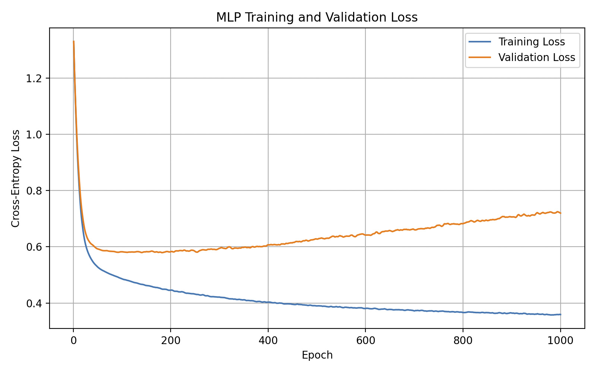

*Figure 3: MLP training and validation cross-entropy loss across 1000 epochs.*

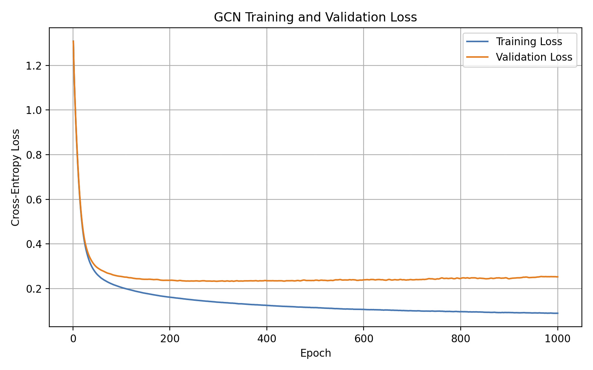

*Figure 4: GCN training and validation cross-entropy loss across 1000 epochs.*

Examining Figures 3 and 4, it is observed that both the MLP and GCN initially experience a 
significant decrease in training and validation loss, indicating that both models are 
learning useful patterns during the early stages of training.

For the MLP in Figure 3, the training loss continues to decrease throughout the 1000 
epochs, while the validation loss begins to increase after approximately 180 epochs. This 
suggests that the MLP begins to overfit the training data, as it continues improving its 
performance on the training nodes while becoming less effective on the validation nodes.
The training loss reducing while validation increasing widens the generalisation gap, 
meaning the model becomes less generalised and overfits more to the training data as 
training continues.

For the GCN in Figure 4, both losses decrease significantly before the validation loss 
begins to stabilise at approximately 0.23. Although the validation loss increases slightly 
towards the later epochs, the increase is significantly smaller than that of the MLP, 
suggesting that the GCN experiences less severe overfitting.

Overall, the GCN achieves a much lower training and validation loss than the MLP, 
indicating that using the graph connections improves the model's ability to learn 
useful patterns while also providing better generalisation to the validation nodes. This 
also shows why selecting the model with the lowest validation loss is good as it avoids 
overfitting to the training set.

## Training and Validation Accuracy Curves
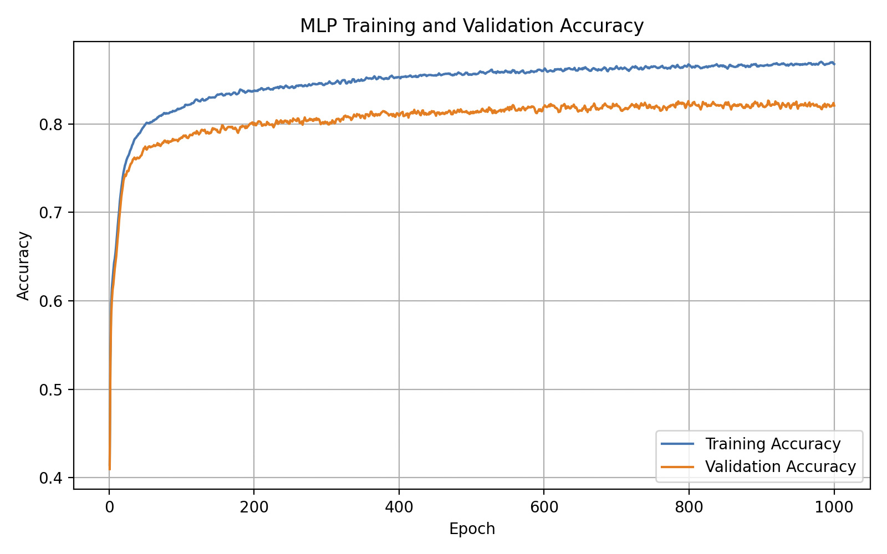

*Figure 5: MLP training and validation accuracy across 1000 epochs.*

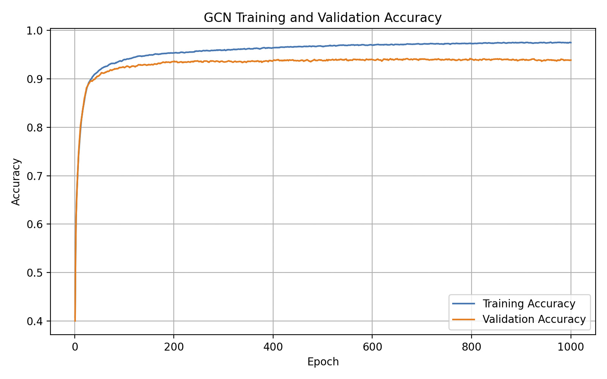

*Figure 6: GCN training and validation accuracy across 1000 epochs.*

Examining Figures 5 and 6, it is observed that both the MLP and GCN experience a 
significant increase in training and validation accuracy during the early epochs, before 
the rate of improvement begins to decrease.

For the MLP in Figure 5, the training accuracy continues to increase throughout the 1000 
epochs, reaching approximately 87%, while the validation accuracy begins to stabilise at 
approximately 82%. The increasing difference between the training and validation accuracy 
suggests that the MLP experiences some overfitting, as it continues to improve on the 
training nodes without achieving similar improvements on the validation nodes.

For the GCN in Figure 6, both training and validation accuracy increase significantly 
before stabilising at approximately 97% and 94%, respectively. The difference between the 
training and validation accuracy remains relatively small compared to the MLP, indicating 
that the GCN generalises better to the validation nodes.

The GCN overall achieves significantly higher training and validation accuracy than the 
MLP, suggesting that graph connections improve the models classification performance.
Although both models show a difference between training and validation accuracy, the GCN 
has higher validation performance with a smaller gap between the two curves.

# Example Inputs, Outputs and Visualisations
## Example Input Graph and Node Features
To demonstrate the input data used by the models, node 0 was selected from the test set. 
The first 10 standardised feature values of this node are shown below, along with its 
connected neighbouring node.

| Property | Value |
|---|---|
| Node ID | 0 |
| Actual Class | 3 (Politicians) |
| First 10 Standardised Features | [-0.8766, -0.0561, -0.0574, -0.0610, 0.1523, 0.1374, 0.3039, 0.7328, 1.9887, -1.2992] |
| Number of Neighbours | 1 |
| Neighbouring Node ID | 18427 |

Examining the input, it is observed that node 0 contains both positive and negative 
standardised feature values, with only one neighbouring node connected to it. The MLP uses 
the node features for classification, while the GCN can also use information from node 
18427 when calculating its hidden features.

## Example Node Classification Predictions
To demonstrate the classification performance of the trained models, the predict.py script 
was used to generate predictions for five nodes from the test set. The predicted classes 
and confidence values of the MLP and GCN are compared below.

| Node ID | Actual Class | MLP Prediction | MLP Confidence | GCN Prediction | GCN Confidence |
|---|---|---|---|---|---|
| 0 | 3 | 0 (Incorrect) | 37.28% | 3 (Correct) | 97.74% |
| 7 | 2 | 2 (Correct) | 89.61% | 2 (Correct) | 98.71% |
| 10 | 1 | 1 (Correct) | 96.26% | 1 (Correct) | 79.64% |
| 18 | 1 | 1 (Correct) | 96.01% | 1 (Correct) | 99.84% |
| 35 | 0 | 0 (Correct) | 44.20% | 0 (Correct) | 99.58% |

Examining these results, it is observed that the GCN correctly classifies all five selected 
nodes, while the MLP incorrectly classifies node 0 as class 0 instead of class 3. The GCN 
also generally produces higher prediction confidence, especially for nodes 0 and 35.

## Class Probabilities and Prediction Confidence
The class probabilities of node 0 were examined to compare how the MLP and GCN classify the
same Facebook page. The probabilities produced by both models are shown below.

| Class | MLP Probability | GCN Probability |
|---|---:|---:|
| Class 0 (Television Shows) | 37.28% | 1.97% |
| Class 1 (Governmental Organisations) | 19.73% | 0.00% |
| Class 2 (Companies) | 8.99% | 0.29% |
| Class 3 (Politicians) | 34.00% | 97.74% |
| **Predicted Class** | **0 (Incorrect)** | **3 (Correct)** |
| **Prediction Confidence** | **37.28%** | **97.74%** |

Examining the probabilities, it is observed that the MLP assigns similar probabilities to 
classes 0 and 3, with class 0 receiving the highest probability of 37.28%. This results in 
an incorrect prediction with relatively low confidence.

The GCN however assigns 97.74% probability to class 3, which is the correct category of 
node 0. This indicates that the GCN is significantly more confident in its prediction for 
this particular node.

However, a high prediction confidence does not necessarily mean that the classification is 
correct. To demonstrate this, node 16052 was also examined, where both models incorrectly 
classify the node as class 2 instead of class 1.

| Class | MLP Probability | GCN Probability |
|---|---:|---:|
| Class 0 (Television Shows) | 1.54% | 0.00% |
| Class 1 (Governmental Organisations) | 5.56% | 0.00% |
| Class 2 (Companies) | 91.20% | 100.00% |
| Class 3 (Politicians) | 1.69% | 0.00% |
| **Predicted Class** | **2 (Incorrect)** | **2 (Incorrect)** |
| **Prediction Confidence** | **91.20%** | **100.00%** |

Examining these results, it is observed that both models incorrectly classify node 16052 
despite having high prediction confidence. The GCN is very overconfident, assigning 
approximately 100% probability to the incorrect class.

This demonstrates that although the GCN can achieve higher classification accuracy, it can 
still produce highly confident incorrect predictions. This is one of the main issues 
investigated in this report.

## Learned Node Embeddings t-SNE
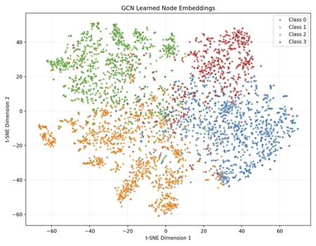

*Figure 7: Two-dimensional t-SNE visualisation of learned GCN node embeddings, coloured by ground-truth class.*

The learned node embeddings of the GCN were visualised using t-distributed Stochastic 
Neighbour Embedding (t-SNE). This technique reduces high-dimensional features into two 
dimensions, allowing the relationships between nodes to be visualised. For this project, 
4,000 nodes were randomly selected for t-SNE visualisation and their 32-dimensional hidden 
features from the first GCN layer were reduced to two dimensions using t-SNE.

Examining Figure 7, it is observed that the nodes form several clusters based on their 
ground-truth classes. Class 0 (Television Shows) is mostly concentrated towards the right, 
Class 1 (Governmental Organisations) towards the lower left, Class 2 (Companies) towards 
the upper left, and Class 3 (Politicians) towards the upper right.

Although the classes form relatively distinct groups, there is still some overlap between 
them, particularly around the centre of the graph. This suggests that the GCN has learned 
useful feature representations which separate the four Facebook page categories, although 
some nodes remain difficult to distinguish based on their learned features.

## Confusion Matrices
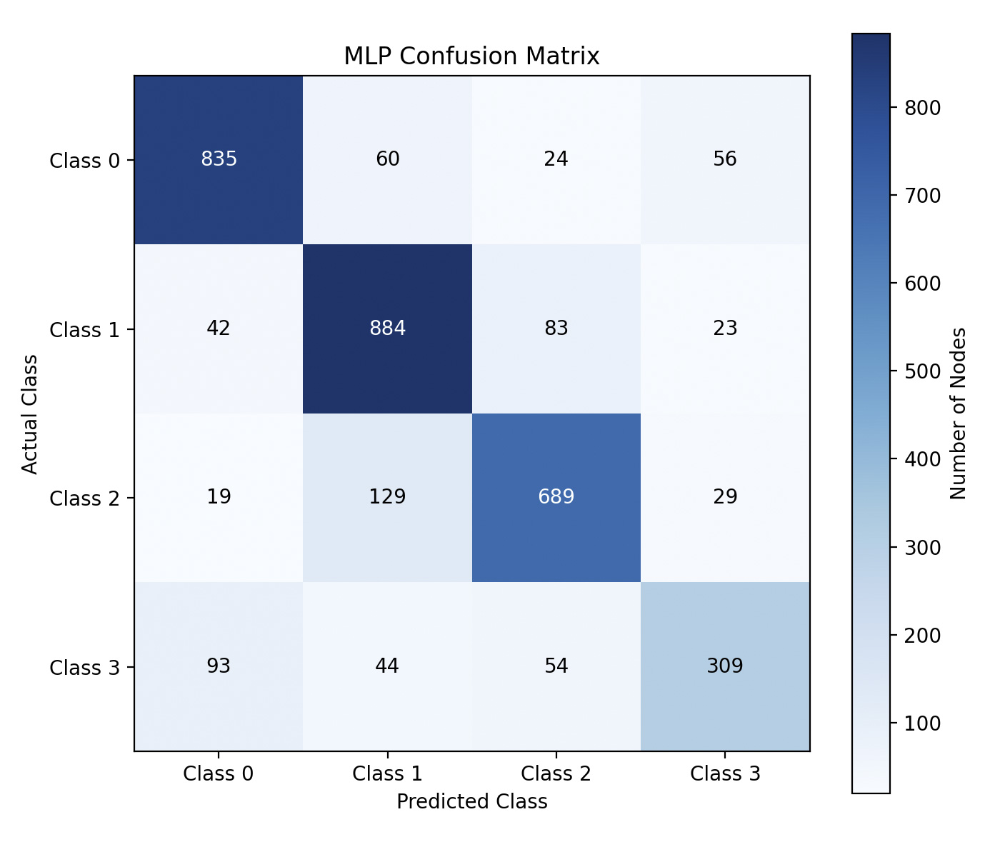

*Figure 8: Confusion matrix showing the MLP's predicted and actual classes on the test set.*

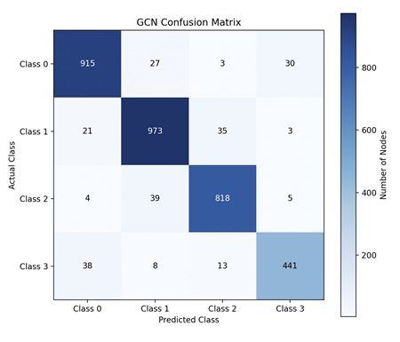

*Figure 9: Confusion matrix showing the GCN's predicted and actual classes on the test set.*

Examining Figures 8 and 9, it is observed that both the MLP and GCN correctly classify the 
majority of test nodes, as shown by the larger values along the diagonal of the confusion 
matrices. However, the GCN achieves significantly more correct classifications across all 
four classes compared to the MLP.

For the MLP in Figure 8, Class 3 (Politicians) has the poorest classification performance, 
with only 309 out of 500 nodes correctly classified. A significant number of these nodes 
are incorrectly classified as Class 0 (Television Shows), with 93 incorrect predictions. 
Another noticeable error occurs for Class 2 (Companies), where 129 nodes are incorrectly 
classified as Class 1 (Governmental Organisations).

For the GCN in Figure 9, the number of correct classifications increases across every 
class. In particular, Class 3 improves from 309 to 441 correctly classified nodes, while 
the incorrect classifications of Class 2 as Class 1 decrease from 129 to 39. This indicates 
that the GCN is more effective at distinguishing between the Facebook page categories.

Overall, the GCN produces fewer classification errors than the MLP, suggesting that 
incorporating graph connections provides useful additional information for classification. 
However, some confusion between the classes remains.

# Investigation of the Open Research Dilemma
## Quantitative Classification Benchmarking
### Experimental Setup and Fair Test Comparison
To compare the classification performance of the MLP and GCN, both models were evaluated 
using the same test set containing 3,373 Facebook pages. The models were trained using the 
same training and validation splits, hyperparameters and random seed, with the best 
checkpoint for each model selected based on validation loss.

The evaluation was performed using accuracy, macro-F1, per-class precision and recall, and 
multiclass AUROC. These metrics were chosen to evaluate not only the overall classification 
performance, but also how effectively the models classify the individual Facebook page 
categories. This is particularly important as the dataset contains some class imbalance, 
meaning overall accuracy alone may not provide a complete indication of model performance.

### Accuracy and Macro-F1 Comparison
The overall test accuracy and macro-F1 results for both models are given below:

| Metric | MLP | GCN |
|---|---:|---:|
| Test Accuracy | 80.55% | 93.30% |
| Macro-F1 | 0.7875 | 0.9292 |

Accuracy represents the proportion of test nodes correctly classified by the model. 
Macro-F1 is the average F1 score across all four classes, where F1 combines precision and 
recall into a single value. Unlike accuracy, macro-F1 gives equal importance to each 
class regardless of how many nodes belong to it, making it useful when the dataset contains 
class imbalance.

Examining the results, it is observed that the GCN achieves a test accuracy of 93.30%, 
which is 12.75 percentage points higher than the MLP's accuracy of 80.55%. The GCN also 
achieves a significantly higher macro-F1 score of 0.9292 compared to 0.7875 for the MLP.

This indicates that the GCN is more effective at correctly classifying the Facebook pages 
while also maintaining better performance across the individual classes. The higher 
macro-F1 score shows that the improvement is not just because of performing well on the 
classes containing the most nodes.

### Per-Class Precision and Recall
To examine how effectively each model classifies the four Facebook page categories, the 
precision, recall and F1 score for each class were calculated.

Precision measures the proportion of predictions made for a particular class which are 
correct, while recall measures the proportion of nodes belonging to that class which are 
correctly identified. The F1 score combines these two measurements into a single value.

The results for both models are given below:

| Class | MLP Precision | MLP Recall | MLP F1 | GCN Precision | GCN Recall | GCN F1 |
|---|---:|---:|---:|---:|---:|---:|
| Class 0 | 0.8443 | 0.8564 | 0.8503 | 0.9356 | 0.9385 | 0.9370 |
| Class 1 | 0.7914 | 0.8566 | 0.8227 | 0.9293 | 0.9428 | 0.9360 |
| Class 2 | 0.8106 | 0.7956 | 0.8030 | 0.9413 | 0.9446 | 0.9429 |
| Class 3 | 0.7410 | 0.6180 | 0.6739 | 0.9207 | 0.8820 | 0.9009 |

Examining the results, it is observed that the GCN outperforms the MLP in precision, recall 
and F1 score for all four classes. This indicates that the GCN is not only more accurate 
overall, but is also more effective at identifying the individual Facebook page categories.

The largest improvement in F1 score occurs for Class 3 (Politicians), where the MLP 
achieves an F1 score of 0.6739 compared to 0.9009 for the GCN. In particular, the recall 
increases from 0.6180 to 0.8820, meaning that the GCN correctly identifies a significantly 
larger proportion of the politicians in the test set.

This is important as Class 3 contains the least number of nodes in the dataset, and so it 
may be more difficult for the models to classify correctly. Although the GCN performs 
better across all four classes, Class 3 still has the lowest recall of 0.8820, 
indicating that there is still some classification difficulty.

### Multiclass AUROC Comparison
The Area Under the Receiver Operating Characteristic Curve (AUROC) was also calculated to 
evaluate how effectively the models distinguish between the four classes using their 
predicted probabilities.

For this project, multiclass AUROC was calculated using the One-vs-Rest (OvR) approach, 
where each class is compared against the other three classes combined. The AUROC scores for 
the four classes are then averaged to produce the macro AUROC.

An AUROC score closer to 1 indicates that a model is better at ranking nodes belonging to a 
particular class above nodes which do not belong to that class. The results are given below:

| Metric | MLP | GCN |
|---|---:|---:|
| Macro AUROC (One-vs-Rest) | 0.9482 | 0.9880 |

Examining the results, it is observed that both models achieve relatively high macro AUROC 
scores, with the GCN achieving the highest score of 0.9880 compared to 0.9482 for the MLP.

This indicates that both models are effective at distinguishing between the four Facebook 
page categories based on their predicted probabilities, however the GCN is much 
more effective. The higher AUROC score also supports the improvements observed in accuracy 
and macro-F1.

## Confidence Reliability and Calibration
### Confidence on Correct and Incorrect Predictions
To investigate whether the MLP and GCN produce reliable confidence scores, the prediction 
confidence was compared between correctly and incorrectly classified nodes in the test set. 
Prediction confidence is calculated as the highest softmax probability produced by the 
model, representing how confident the model is in its selected class.

A model with reliable confidence scores should generally produce higher confidence for 
correct predictions and lower confidence for incorrect predictions. This is important 
because incorrect predictions made with high confidence may be automatically accepted 
without being identified for further review.

The mean confidence values for both models are given below:

| Metric | MLP | GCN |
|---|---:|---:|
| Mean Confidence (Correct Predictions) | 83.40% | 94.84% |
| Mean Confidence (Incorrect Predictions) | 57.41% | 74.14% |

Examining the results, it is observed that both models produce higher average confidence 
for correct predictions than incorrect predictions. The MLP achieves a mean confidence of 
83.40% for correct predictions compared to 57.41% for incorrect predictions, while the GCN 
achieves 94.84% for correct predictions and 74.14% for incorrect predictions.

Although the GCN is more confident when its predictions are correct, it also produces 
higher confidence when its predictions are incorrect. This indicates that the GCN's higher 
classification accuracy does not necessarily mean that its incorrect predictions are 
assigned low confidence.

The confidence distributions for both models are shown in Figures 10 and 11.

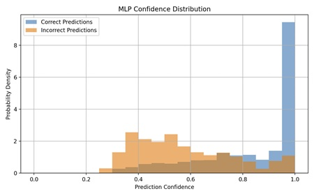

*Figure 10: Distribution of MLP prediction confidence for correctly and incorrectly classified test nodes.*

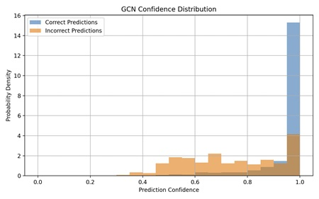

*Figure 11: Distribution of GCN prediction confidence for correctly and incorrectly classified test nodes.*

Examining Figure 10, it is observed that the MLP produces a wider distribution of 
confidence values for both correct and incorrect predictions. Most incorrect predictions 
are concentrated around confidence values of 0.3 to 0.6, although some incorrect 
predictions still occur at high confidence values close to 1.0. It is seen however that the
MLP generally is lower in confidence for incorrect predictions, but high for correct.

For the GCN in Figure 11, the majority of correct predictions are concentrated at 
confidence values close to 1.0, indicating that the model is highly confident for most 
correctly classified nodes. However, incorrect predictions are also high in confidence 
closer to 1.0 with a peak at around 1.0. This indicates that although the GCN is a lot more
confident in its correct predictions, a large portion of incorrect predictions are also 
predicted with high confidence.

This suggests that prediction confidence can provide useful information for identifying 
potentially incorrect classifications, as incorrect predictions generally have lower 
confidence. However, the overlap between correct and incorrect predictions means that 
confidence alone cannot reliably identify every classification error.

### Expected Calibration Error (ECE)
To further investigate confidence reliability, the Expected Calibration Error (ECE) was 
calculated for both models. ECE measures how closely a model's prediction confidence 
corresponds to its actual classification accuracy.

For example, if a model makes predictions with an average confidence of 80%, approximately 
80% of these predictions should be correct for the model to be well calibrated.

ECE is calculated by dividing predictions into confidence intervals, comparing the average 
confidence with the actual accuracy within each interval, and calculating a weighted 
average of the differences.

The ECE can be represented by:

```math
ECE = \sum_{m=1}^{M} \frac{|B_m|}{N} \left| acc(B_m) - conf(B_m) \right|
```

Where:
* $M$ is the number of confidence intervals, which is 10 for this project.
* $B_m$ represents the predictions belonging to confidence interval $m$.
* $|B_m|$ is the number of predictions in the interval.
* $N$ is the total number of predictions.
* $acc(B_m)$ is the actual classification accuracy within the interval.
* $conf(B_m)$ is the average prediction confidence within the interval.

A lower ECE indicates that the model's confidence scores are more closely aligned with its 
actual accuracy, with a value of zero representing perfect calibration under the chosen 
intervals.

The ECE results are given below:

| Metric | MLP | GCN |
|---|---:|---:|
| Expected Calibration Error (ECE) | 0.0427 | 0.0146 |

Examining the results, it is observed that the GCN achieves a significantly lower ECE of 
0.0146 compared to 0.0427 for the MLP. This indicates that the GCN's confidence scores are 
generally better calibrated and correspond more closely to its observed classification 
accuracy.

However, ECE represents an average calibration error across the test set, meaning that a 
low ECE does not guarantee that every individual prediction has reliable confidence. A 
model can still produce highly confident incorrect predictions even when its overall 
calibration is good, as seen by Figure 11 above.

### Reliability Diagrams and Calibration Analysis
Reliability diagrams were also generated to visually examine how closely the confidence 
scores correspond to actual classification accuracy. These diagrams compare the average 
prediction confidence with the observed accuracy for groups of predictions.

The dashed diagonal line represents perfect calibration, where the average prediction 
confidence is equal to the actual accuracy. Points above the diagonal indicate that the 
model is underconfident, as its actual accuracy is higher than its confidence. Points below 
the diagonal indicate overconfidence, where the model's confidence is higher than its 
actual accuracy.

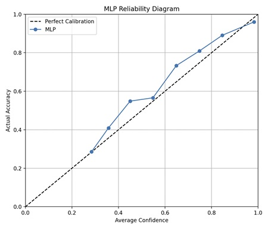

*Figure 12: MLP reliability diagram comparing average prediction confidence with observed classification accuracy.*

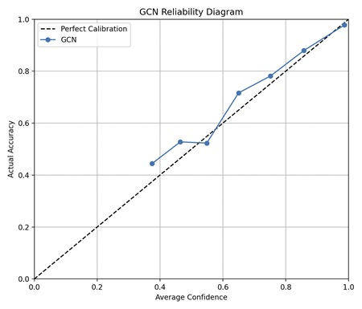

*Figure 13: GCN reliability diagram comparing average prediction confidence with observed classification accuracy.*

Examining Figure 12, it is observed that the MLP's reliability curve is generally above the 
perfect calibration line across most confidence intervals. This indicates that the MLP is 
generally underconfident, as its observed classification accuracy is higher than its 
average prediction confidence. However, at the highest confidence interval, the curve falls 
slightly below the diagonal, indicating some overconfidence.

For the GCN in Figure 13, the reliability curve is generally closer to the perfect 
calibration line, particularly for the higher confidence intervals. This supports the lower 
ECE achieved by the GCN and indicates that its confidence scores better represent 
its actual classification accuracy.

However, the GCN also shows some deviations from perfect calibration, including 
underconfidence in several intermediate confidence intervals and slight overconfidence at 
the highest confidence interval.

Overall, the reliability diagrams support the ECE results, indicating that the GCN produces 
better calibrated confidence scores than the MLP. However, neither model is perfectly 
calibrated, and both can still produce confident incorrect predictions.

## Confidence Threshold and Manual Review
### Confidence Threshold Selection
To reduce the risk of automatically accepting incorrect classifications, a confidence 
threshold is used. Predictions with confidence equal to or above the selected 
threshold are automatically accepted, while predictions below the threshold are sent for 
manual review.

The purpose is to achieve high accuracy for automatically accepted predictions while 
keeping the number of predictions requiring manual review as low as possible. This means 
there needs to be a good balance between classification accuracy and manual review 
workload, as increasing the confidence threshold generally improves the reliability of 
accepted predictions but also increases the number of pages which require manual review.

For this project, a target accepted prediction accuracy of 95% was chosen. The confidence 
threshold was selected using the validation set rather than the test set, to prevent the 
final test results from influencing the selection.

The script evaluates confidence thresholds from 0.50 to 0.99 in increments of 0.01 and 
selects the first threshold which achieves at least 95% accuracy among the automatically 
accepted validation predictions.

The selected thresholds and validation results are given below:

| Metric | MLP | GCN |
|---|---:|---:|
| Target Accepted Accuracy (Validation) | 95% | 95% |
| Selected Confidence Threshold | 0.86 | 0.56 |
| Validation Accepted Accuracy | 95.36% | 95.02% |

Examining the results, it is observed that the MLP requires a confidence threshold of 0.86 
to achieve the target accuracy, while the GCN only requires a threshold of 0.56.

This indicates that the GCN can accept predictions with lower confidence while still 
achieving the desired accuracy on the validation set. In comparison, the MLP requires much 
higher confidence before a prediction can be automatically accepted.

Both models achieve the target validation accuracy, with the MLP reaching 95.36% and the 
GCN reaching 95.02%. These thresholds were then applied to the test set to evaluate how 
effectively they generalise to the final classification results.

### Automatically Accepted Prediction Accuracy
After selecting the confidence thresholds using the validation set, these thresholds were 
applied to the test set. The accuracy was calculated using only the predictions which were 
automatically accepted, allowing the performance of the confidence-based filtering system 
to be evaluated.

The results are given below:

| Metric | MLP | GCN |
|---|---:|---:|
| Overall Test Accuracy | 80.55% | 93.30% |
| Accepted Test Prediction Accuracy | 95.73% | 94.51% |

Examining the results, it is observed that both models achieve a higher accepted prediction 
accuracy compared to their original test accuracy.

For the MLP, the accuracy increases from 80.55% to 95.73%, meaning that the confidence 
threshold is able to successfully filter the data to give predictions with much larger
accuracy.

For the GCN, the accuracy increases from 93.30% to 94.51%. Although this is an improvement, 
the accepted prediction accuracy does not reach the original target of 95% on the test set, 
despite achieving 95.02% on the validation set.

This indicates that the threshold selected using the validation set does not perfectly 
generalise to the test set. The difference is relatively small, but it shows that 
a target accuracy on validation data does not guarantee that the same accuracy 
will be achieved on unseen test data.

Examining the MLP, it is seen that it achieves a slightly higher accepted test prediction 
accuracy than the GCN, despite having significantly lower overall test accuracy. However,
the number of predictions each model sends for manual review must also be considered.

### Manual Review Workload
Although higher confidence thresholds can improve the accuracy of automatically accepted 
predictions, they can also increase the number of predictions requiring manual review.

To evaluate this, the percentage of automatically accepted predictions and the percentage 
sent for manual review were calculated for both models using their selected thresholds.

The results are given below:

| Metric | MLP | GCN |
|---|---:|---:|
| Automatically Accepted Predictions | 48.65% | 97.15% |
| Predictions Sent for Manual Review | 51.35% | 2.85% |

Examining the results, it is observed that the MLP automatically accepts only 48.65% of the 
test predictions, meaning that 51.35% must be sent for manual review to achieve an 
accepted prediction accuracy of 95.73%.

Examining the GCN however, it is seen that it automatically accepts 97.15% of the 
predictions, with only 2.85% requiring manual review. This is a significant reduction in 
manual review workload compared to the MLP.

This indicates that the GCN is more suitable for automatic classification, as it can 
classify the majority of Facebook pages without requiring manual review while still 
maintaining relatively high accuracy.

So despite the MLP having slightly more test accuracy, the GCN requires significantly less
manual review for a similar accuracy result.

### Accuracy–Workload Trade-off
To further investigate the relationship between accepted prediction accuracy and manual 
review workload, the confidence threshold was varied and the resulting accuracy and review 
percentage were plotted.

These graphs show how the accuracy of automatically accepted predictions changes as more 
uncertain predictions are excluded and sent for manual review. The selected 
validation-based thresholds are also marked on the graphs.

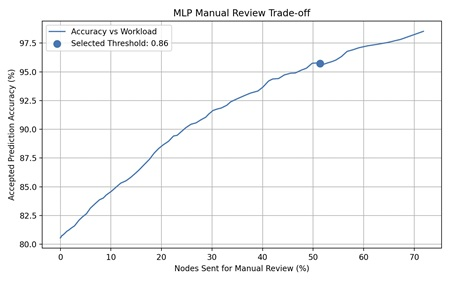

*Figure 14: MLP trade-off between automatically accepted prediction accuracy and the percentage of test nodes sent for manual review.*

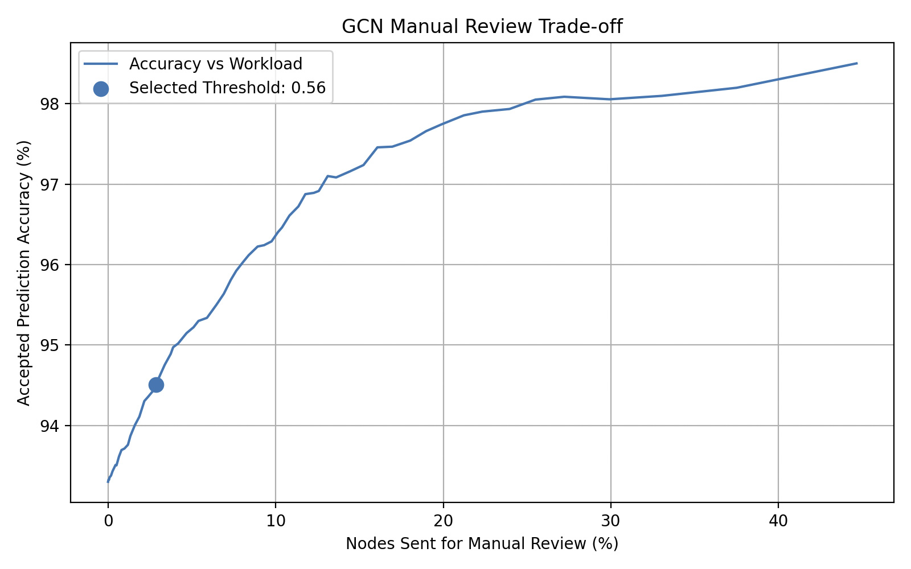

*Figure 15: GCN trade-off between automatically accepted prediction accuracy and the percentage of test nodes sent for manual review.*

Examining Figures 14 and 15, it is observed that both models generally achieve higher 
accepted prediction accuracy as the percentage of nodes sent for manual review increases. 
This occurs because increasing the confidence threshold removes more low-confidence 
predictions from automatic classification, which tend to be incorrect.

For the MLP in Figure 14, the accepted prediction accuracy increases steadily as more nodes 
are sent for manual review. To achieve an accuracy above 95%, approximately half of the 
test predictions must be excluded from automatic classification. This indicates that the 
MLP requires a relatively large manual review workload to achieve high accepted prediction 
accuracy.

For the GCN in Figure 15, the accepted prediction accuracy begins at 93.30% when no nodes 
are sent for manual review, which is already significantly higher than the MLP's initial 
accuracy of 80.55%. The accuracy then increases as more nodes are reviewed, reaching 
approximately 95% when around 4% of the test predictions are sent for manual review.

The selected GCN threshold of 0.56 sends only 2.85% of predictions for manual review and 
achieves an accepted prediction accuracy of 94.51%. Although this is slightly below the 
target, Figure 15 shows that a higher threshold could improve accepted accuracy at the 
cost of a larger manual review workload.

Overall, the results show that the GCN provides a significantly better balance between 
automatic classification accuracy and manual review workload than the MLP. Although neither 
model can guarantee that all incorrect predictions will be identified using confidence 
alone, the GCN can automatically classify a much larger proportion of the test nodes while 
maintaining high accuracy.

This suggests that incorporating graph connections improves not only classification 
performance but also the practicality of using confidence thresholds to reduce manual 
classification workload. However, the highly confident incorrect predictions 
demonstrate that further investigation of individual failure cases is still important.

## Computational Resource Usage Comparison
To investigate whether the additional computational cost of the GCN is justified by its 
classification performance, both models were evaluated based on their number of trainable 
parameters, inference time and GPU memory usage.

Although the GCN achieves higher classification accuracy and better confidence calibration, 
it is important to determine whether more computational resources are required for these 
improvements compared to the simpler MLP baseline. This is especially important for 
applications where large numbers of Facebook pages must be classified efficiently.

### Model Parameter Count
Both the MLP and GCN contain 4,260 trainable parameters, as they use the same input, hidden 
and output dimensions. However, the GCN requires additional computation because it combines 
information from neighbouring nodes, while the MLP only considers the individual node 
features.

### Inference Runtime and Latency

The CPU and GPU inference times measured for both models are given below:

| Metric | MLP | GCN |
|---|---:|---:|
| Average Inference Time (CPU) | 1.499 ms | 36.090 ms |
| Average Inference Time (GPU) | 0.225 ms | 1.789 ms |

Examining the CPU results, it is observed that the MLP completes inference in 1.499 ms 
compared to 36.090 ms for the GCN, making the GCN approximately 24 times slower. This is 
expected as the GCN uses neighbouring node information, while the MLP only 
performs fully connected operations, meaning calculation is slower.

Examining the GPU results, the MLP achieves an inference time of 0.225 ms compared to 1.789 
ms for the GCN. Although the GCN remains approximately 8 times slower than the MLP, both 
models perform inference significantly faster on the GPU than on the CPU.

This indicates that GPU acceleration is useful for the GCN because its graph 
convolution operations require more computation. Despite this additional cost, both models 
remain well below the inference time target of five seconds.

### Peak GPU Memory Usage

Peak GPU memory was measured using PyTorch's `torch.cuda.max_memory_allocated()` function, 
which records the maximum GPU memory allocated by PyTorch. Separate measurements were taken 
during training and inference on the Rangpur computing cluster.

The results are given below:

| Metric | MLP | GCN |
|---|---:|---:|
| Peak Training GPU Memory | 42.33 MiB | 134.07 MiB |
| Peak Inference GPU Memory | 38.63 MiB | 134.47 MiB |

Examining the training results, it is observed that the GCN uses 134.07 MiB compared to 42.
33 MiB for the MLP, requiring approximately 3.17 times more GPU memory. This is expected as 
the GCN must process graph connections and store intermediate representations during 
backpropagation, while the MLP only processes individual node features.

Examining the inference results, the GCN also requires more memory, using 134.47 MiB 
compared to 38.63 MiB for the MLP. This means that the GCN requires approximately 3.48 
times more GPU memory during inference.

It is also observed that the GCN's peak inference memory is slightly higher than its peak 
training memory. This difference is relatively small and may be caused by differences in 
the operations performed and tensors retained during the two measurements.

Overall, both models remain well below the proposed 2 GB GPU memory target during training 
and inference, indicating that the additional memory requirements of the GCN are acceptable 
for this dataset.

### Computational Efficiency Comparison
The overall computational resource measurements are summarised below:

| Metric | MLP | GCN |
|---|---:|---:|
| Model Parameters | 4,260 | 4,260 |
| Average Inference Time (CPU) | 1.499 ms | 36.090 ms |
| Average Inference Time (GPU) | 0.225 ms | 1.789 ms |
| Peak Training GPU Memory | 42.33 MiB | 134.07 MiB |
| Peak Inference GPU Memory | 38.63 MiB | 134.47 MiB |

Overall, the MLP is more computationally efficient than the GCN, achieving faster inference 
and lower GPU memory usage while containing the same number of trainable parameters.

However, the GCN achieves significantly higher classification accuracy and macro-F1, 
suggesting that its additional computational cost provides a meaningful improvement in 
classification performance.

Furthermore, both models satisfy the proposed inference-time and GPU memory targets. 
Therefore, the additional computational requirements of the GCN are acceptable for this 
dataset and do not prevent it from being a practical solution for classifying Facebook 
pages.

## Qualitative Failure Analysis
### Failure Case Selection Method
To investigate why the MLP and GCN incorrectly classify certain Facebook pages, five 
cases were selected from the test set which all have high-confidence errors. 
For each case, both model predictions were compared alongside the class distribution of 
direct and two-hop neighbours of that node and the mean cosine similarity between the node 
and its direct neighbours to see what causes such high confidence incorrect predictions.

The selected cases are given below:

| Node ID | Actual Class | MLP Prediction | MLP Confidence | GCN Prediction | GCN Confidence | Mean Cosine Similarity |
|---|---|---|---:|---|---:|---:|
| 16052 | 1 | 2 (Incorrect) | 91.20% | 2 (Incorrect) | 100.00% | 0.3768 |
| 9254 | 0 | 3 (Incorrect) | 99.22% | 3 (Incorrect) | 100.00% | 0.0594 |
| 9708 | 3 | 0 (Incorrect) | 99.74% | 0 (Incorrect) | 100.00% | 0.2417 |
| 2924 | 0 | 1 (Incorrect) | 99.99% | 0 (Correct) | 86.43% | 0.0548 |
| 12241 | 3 | 2 (Incorrect) | 99.99% | 2 (Incorrect) | 65.74% | 0.0833 |

Examining the results, both models incorrectly classify four of the five nodes, while the 
GCN corrects the MLP's prediction for node 2924. It is also observed that the GCN produces 
approximately 100% confidence for three incorrect predictions, demonstrating that high 
confidence does not always indicate correctness.

### Failure Case 1: Node 16052
Node 16052 belongs to Class 1 (Governmental Organisations), however both models incorrectly 
classify it as Class 2 (Companies). The MLP produces 91.20% confidence, while the GCN 
produces approximately 100%.

The neighbourhood class distribution is given by:

| Class | Direct Neighbours | Two-Hop Neighbours |
|---|---:|---:|
| Class 0 | 0 (0.00%) | 31 (9.09%) |
| Class 1 | 1 (0.38%) | 129 (37.83%) |
| Class 2 | 265 (99.62%) | 169 (49.56%) |
| Class 3 | 0 (0.00%) | 12 (3.52%) |
| **Total** | **266** | **341** |

Examining the results, 265 of the 266 direct neighbours of the node belong to companies 
(99.62%), while companies also represent the largest proportion of two-hop neighbours 
(49.56%). This demonstrates that large connections to class 2 contribute to the GCN's 
incorrect prediction.

The mean cosine similarity to direct neighbours is 0.3768, indicating some positive 
similarity between their features. However, the MLP also incorrectly classifies the node 
without using graph connections, suggesting that an overlap in the node's features to 
features seen in class 2 nodes may contribute to the misclassification. Overall, both the 
similar node features and misleading graph connections may contribute to this error.

### Failure Case 2: Node 9254
Node 9254 belongs to Class 0 (Television Shows), however both models incorrectly classify 
it as Class 3 (Politicians). The MLP produces 99.22% confidence, while the GCN produces 
approximately 100%.

The neighbourhood class distribution is given below:

| Class | Direct Neighbours | Two-Hop Neighbours |
|---|---:|---:|
| Class 0 | 1 (6.25%) | 35 (19.23%) |
| Class 1 | 0 (0.00%) | 7 (3.85%) |
| Class 2 | 0 (0.00%) | 17 (9.34%) |
| Class 3 | 15 (93.75%) | 123 (67.58%) |
| **Total** | **16** | **182** |

Examining the results, politicians account for 93.75% of direct neighbours and 67.58% of 
two-hop neighbours. This suggests that the surrounding graph structure may influence the 
GCN towards the incorrect category.

The mean cosine similarity to direct neighbours is only 0.0594, indicating very little 
average similarity between their features. Despite this, both models produce extremely 
confident incorrect predictions. This suggests that overlapping node features could be a 
potential cause, and combined with misleading graph connections may both contribute to the 
error.

### Failure Case 3: Node 9708
Node 9708 belongs to Class 3 (Politicians), however both models incorrectly classify it as 
Class 0 (Television Shows). The MLP produces 99.74% confidence, while the GCN produces 
approximately 100%.

The neighbourhood class distribution is given below:

| Class | Direct Neighbours | Two-Hop Neighbours |
|---|---:|---:|
| Class 0 | 1 (100.00%) | 3 (100.00%) |
| Class 1 | 0 (0.00%) | 0 (0.00%) |
| Class 2 | 0 (0.00%) | 0 (0.00%) |
| Class 3 | 0 (0.00%) | 0 (0.00%) |
| **Total** | **1** | **3** |

Examining the results, node 9708 has only one direct neighbour and three two-hop 
neighbours, all belonging to television shows. This means that the GCN has very little 
neighbouring information available, with all surrounding nodes belonging to the incorrect 
class.

The mean cosine similarity to its direct neighbour is 0.2417, indicating some positive 
feature similarity. The MLP also incorrectly classifies the node with high confidence, 
suggesting that its own features may contribute to the error.

Unlike node 9254, which has 16 direct neighbours, node 9708 has only one. This demonstrates 
that misleading graph information may contribute to incorrect classifications regardless of 
whether the neighbourhood contains many or very few connections.

### Failure Case 4: Node 2924
Node 2924 belongs to Class 0 (Television Shows). The MLP incorrectly classifies it as Class 
1 (Governmental Organisations) with 99.99% confidence, while the GCN correctly predicts 
Class 0 with 86.43% confidence.

The neighbourhood class distribution is given below:

| Class | Direct Neighbours | Two-Hop Neighbours |
|---|---:|---:|
| Class 0 | 5 (71.43%) | 33 (10.34%) |
| Class 1 | 2 (28.57%) | 281 (88.09%) |
| Class 2 | 0 (0.00%) | 4 (1.25%) |
| Class 3 | 0 (0.00%) | 1 (0.31%) |
| **Total** | **7** | **319** |

Examining the results, five of the seven direct neighbours belong to television shows 
(71.43%), providing information which may support the GCN's correct prediction. However, 
88.09% of two-hop neighbours belong to governmental organisations, indicating that much 
of the surrounding graph is associated with the incorrect class.

The mean cosine similarity to direct neighbours is only 0.0548, indicating low average 
feature similarity. Despite this and the misleading two-hop neighbourhood, the GCN 
correctly classifies the node, most likely due to the cosine similarity being really low, 
but also the influence of the majority correct class direct neighbours. Despite correct 
prediction it is seen that the GCN has lower than 90% confidence and so the two hop 
neighbourhood does reduce this confidence in its prediction.

This demonstrates that the GCN does not simply predict the most common neighbouring class in
its two-hop nieghbourhood, but combines node features with learned information from graph 
connections. Overall, this case demonstrates how graph information can help correct a highly 
confident MLP error.

### Failure Case 5: Node 12241
Node 12241 belongs to Class 3 (Politicians), however both models incorrectly classify it as 
Class 2 (Companies). The MLP produces 99.99% confidence, while the GCN produces 65.74%.

The neighbourhood class distribution is given below:

| Class | Direct Neighbours | Two-Hop Neighbours |
|---|---:|---:|
| Class 0 | 0 (0.00%) | 8 (1.62%) |
| Class 1 | 1 (10.00%) | 50 (10.14%) |
| Class 2 | 5 (50.00%) | 372 (75.46%) |
| Class 3 | 4 (40.00%) | 63 (12.78%) |
| **Total** | **10** | **493** |

Examining the results, 50% of direct neighbours belong to companies while 40% belong to 
politicians. However, companies dominate the two-hop neighbourhood at 75.46%, which may 
contribute to the GCN's incorrect prediction. The mean cosine similarity to direct 
neighbours is also low at 0.0833.

The class probabilities produced by both models are given below:

| Class | MLP Probability | GCN Probability |
|---|---:|---:|
| Class 0 | 0.00% | 0.76% |
| Class 1 | 0.00% | 11.24% |
| Class 2 | 99.99% | 65.74% |
| Class 3 | 0.01% | 22.25% |

Examining these probabilities, the GCN reduces the incorrect company probability from 
99.99% to 65.74% and increases the correct politician probability from 0.01% to 22.25%. 
This suggests that neighbouring information may provide some evidence supporting the 
correct class, although it is insufficient to correct the prediction.

However, the GCN's confidence of 65.74% remains above the selected manual-review threshold 
of 0.56, meaning this incorrect prediction would still be automatically accepted. Overall, 
this case demonstrates that reducing confidence in an incorrect prediction does not 
guarantee that the manual-review system will identify it.

### Common Failure Modes and Root Causes
Examining the five cases, it is observed that misleading graph connections and limited 
neighbourhood information may contribute to incorrect GCN predictions. However, the results 
also demonstrate that incorporating graph information can correct highly confident MLP 
errors, as seen for node 2924.

Another important observation is that both models can produce highly confident incorrect 
predictions. Even when the GCN reduces confidence in an incorrect prediction, as seen for 
node 12241, it may still remain above the manual-review threshold and be automatically 
accepted.

Overall, these results demonstrate that although the GCN improves classification 
performance, it remains vulnerable to misleading graph information and overconfident 
predictions. The neighbourhood analysis suggests possible causes, however even without the 
influence of connected nodes, the MLP still has high confidence so feature overlap with other
classes could be a reason for both the MLP and GCN having high confidence incorrect 
predictions.

## Engineering Recommendation and Trade-offs
### Classification Accuracy versus Confidence Reliability
Examining the results, it is observed that the GCN achieves higher classification accuracy 
and better confidence calibration than the MLP. However, both models still produce highly 
confident incorrect predictions, meaning that a lower ECE does not guarantee that every 
prediction is reliable. Therefore, confidence thresholds are useful for identifying 
uncertain predictions, but cannot eliminate all classification errors.

### Performance versus Computational Cost
The GCN requires more computational resources than the MLP, particularly during inference, 
due to the additional graph convolution operations. However, both models remain well below 
the proposed GPU memory and inference-time targets. This indicates that the improved 
classification performance of the GCN justifies its additional computational requirements 
for this dataset.

### MLP versus GCN: Recommended Model
Based on the experimental results, the GCN is recommended over the MLP for classifying 
Facebook pages. The GCN achieves higher accuracy, macro-F1 and better confidence 
calibration, while also requiring fewer predictions to be sent for manual review. Although 
the MLP is more computationally efficient, the improvements achieved by the GCN make it the 
more suitable model for this application.

### Deployment Recommendations and Limitations
For practical use, the GCN should be combined with the proposed confidence-based 
manual-review system, where predictions below the selected threshold of 0.56 are sent for 
review. However, some incorrect predictions may still be automatically accepted with high 
confidence, meaning the system should not be relied upon without additional monitoring. 
Further improvements to confidence calibration and threshold selection may help reduce these 
errors, but also considering the reliability of the dataset and investigating graph 
connections.

# Conclusion
## Summary of Findings
This project investigated whether a two-layer GCN could improve classification performance 
and confidence reliability compared to an MLP baseline when classifying Facebook pages. The 
results demonstrate that the GCN achieves higher accuracy, macro-F1 and better confidence 
calibration by incorporating information from neighbouring nodes. However, the qualitative 
failure analysis also demonstrates that misleading graph connections can contribute to 
highly confident incorrect predictions.

## Acceptance Criteria Evaluation
Overall, the project successfully evaluated all five acceptance criteria in the feasibility 
review. The GCN outperformed the MLP in classification performance and confidence 
calibration, while the manual-review system was successfully implemented and evaluated. Both 
models satisfied the proposed computational resource limits, and five representative failure 
cases were investigated.

## Limitations and Future Improvements
The main limitations of the GCN are its dependence on graph connections and its ability to 
produce highly confident incorrect predictions. As demonstrated by the failure analysis, 
misleading or limited neighbouring information may contribute to classification errors that 
are not identified by the manual-review threshold. Future improvements could investigate 
alternative confidence calibration methods, different threshold selection strategies and 
more advanced GNN architectures to determine whether these limitations can be reduced.

# Artificial Intelligence Usage Disclosure
Artificial intelligence was used for the development of this report and also for coding the
models, dataset loading and training procedures. The AI tool used was ChatGPT which was used
for the following tasks:
- Debugging code
- Teaching me how to use the libraries for developing the MLP and GCN models, and also giving
me the code for these models.
- Teaching me the key mathematical concepts required for each model and giving the equations
I could use in the report
- Helping to fix incorrect dataset formatting from download link by giving conversion file
so data can be used by PyTorch Geometric
- Generating images of the MLP and GCN model structures which were decided to be used for 
this report
- Generating titles for sections of the report
- Spelling checks and fixing gramatical errors
- Documenting code and checking over documentation spelling
- Reducing word count on report
- Generating markdown tables based on the exprerimental results I've generated from training
both models separately.
- Teaching me every old and new concept in this report which I was not too familiar with 
such as the ECE, t-SNE, precision, recall, F1, AUROC, calibration, how the ADAM optimiser 
worked and also what to look for when analysing such information.
- The train.py, predict.py, modules.py, dataset.py, inspect_node.py and convert_dataset.py
have all used AI in some stage of their development to check for debugging, code syntax, 
generate required code functionalities, and documentation. All code files have been checked 
that they are correct and complete the task correctly.

The way I would verify and test the AI generated code was I would first look though each 
line and use the prompt:

"For this code: (code) explain every line and what its purpose is."

Secondly I would test and train the models repeatedly and check that every required statistic
and plot is used and printed. Then I would look over all the statistics and check whether 
they realistically match up to what is expected for that metric. For the plots aswell I 
would compare them to ones found online for similar models to ensure they correctly 
represent the data. Mathematical concepts were also checked online to verify they are 
correct.

Any incorrect code, explanation, or functionality resulting from halluciations were 
identified and removed. 


# Feasability Review (Checked off on 6/10/2026)
## User Need, Scope & Acceptance Criteria
This multi-layer GNN project will develop a two-layer Graph Convolutional Network (GCN) 
to classify Facebook pages as politicians, governmental organisations, television shows 
or companies. The intended users are social network analysts seeking to reduce manual classification. 
The project will investigate whether the GCN produces more reliable confidence scores on ambiguous 
predictions than a Multi-Layer Perceptron (MLP) baseline. The acceptance criteria are:
1.	Classification: Achieve reasonable accuracy and compare macro-F1, per-class precision/recall and multiclass AUROC against the MLP.
2.	Confidence: Compare confidence on correct and incorrect predictions and measure Expected Calibration Error (ECE).
3.	Manual review: Establish a confidence threshold and measure accepted-prediction accuracy and manual review workload.
4.	Resources: Compare inference time, parameter count and peak GPU memory, targeting under 2 GB VRAM and 5 seconds for test-set inference.
5.	Failure analysis: Investigate at least three ambiguous or incorrectly classified nodes.

## Model Choice & Course Concepts
The Facebook Page-Page Network contains 22,470 nodes, 171,002 undirected connections, 
128-dimensional features and four classes. A two-layer GCN implemented in PyTorch 
Geometric will combine node features with information from up to two-hop neighbours. 
An MLP using only node features will serve as the baseline to evaluate whether graph 
connections improve classification and confidence reliability. Rozemberczki et al. [1] 
reported a GCN micro-F1 of 0.932 on this dataset. Their configuration of 32 hidden filters, 
Adam, learning rate 0.01 and dropout 0.5 will be used initially. The project is classified 
as Normal Difficulty and applies graph convolutions, feature representations, 
regularisation and model evaluation. Transductive semi-supervised learning will be used, 
with test labels excluded from training. Learned embeddings will be visualised using t-SNE 
or UMAP.

## Preliminary Feasibility Evidence
An initial dataset audit was completed using PyTorch Geometric. The dataset loaded 
successfully with 22,470 nodes, 342,004 directed edge entries, 128 features per node 
and four classes. The class distribution ranged from 3,327 nodes (14.81%) to 6,880 
nodes (30.62%), indicating some class imbalance. The audit confirms that the dataset 
was successfully loaded and contains the expected node features and classification 
labels. The uneven class distribution also shows why it is important to evaluate 
performance across individual classes rather than relying on overall accuracy. Model 
training and confidence reliability have not yet been tested.

## Risks, Budget & Fallback
The main risks are misleading graph connections, overconfident predictions and label 
leakage. These will be addressed through held-out evaluation, confidence analysis and 
training-label masking. The initial GCN will train for up to 200 epochs within a 
proposed 30-minute training budget and 2 GB VRAM limit. Runtime and memory usage 
will be measured. The next experiment will establish reproducible train/validation/test 
splits and train an MLP baseline. If GCN performance is poor, hyperparameters will be 
adjusted. If it offers little improvement, the MLP will remain the simpler fallback.

# References:
[1] B. Rozemberczki, C. Allen, and R. Sarkar, “Multi-Scale Attributed Node Embedding,” Journal of Complex Networks, 2021. [Online]. Available: https://arxiv.org/abs/1909.13021

[2] Stanford Network Analysis Project (SNAP), “Facebook Large Page-Page Network,” Stanford University. [Online]. Available: https://snap.stanford.edu/data/facebook-large-page-page-network.html

[3] PyTorch Geometric, “torch_geometric.datasets.FacebookPagePage,” PyTorch Geometric Documentation, Version 2.6.0. [Online]. Available: https://pytorch-geometric.readthedocs.io/en/2.6.0/generated/torch_geometric.datasets.FacebookPagePage.html