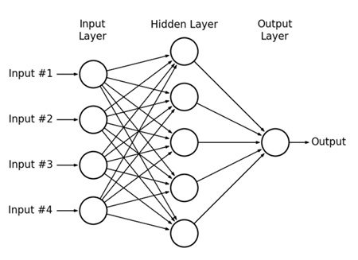
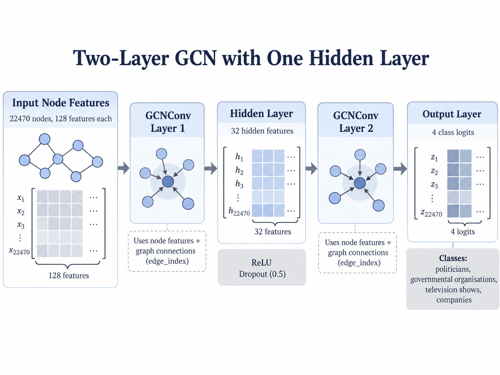

# COMP3710 Project: Multi-layer Graph Neural Network for Classifying Facebook Pages

## The Open Research Question
In web-scale graph classification, models frequently achieve deceptively high aggregate
test accuracy while concealing catastrophic overconfidence on borderline, ambiguous, 
or out-of-distribution cases. This can be problematic for automatic classification, as 
incorrect predictions may not be identified for further review because the model is 
extremely confident in its classification. The intended users who would benefit from
automatic classification are social network analysts seeking to reduce manual 
classification, so it is important that the model works effectively.

This project will investigate whether a multi-layer Graph Neural Network (GNN),
that is, a two-layer Graph Convolutional Network (GCN), can produce a more reliable 
confidence score than a Multi-Layer Perceptron (MLP) baseline when classifying facebook 
pages.

A confidence threshold will be investigated to determine whether uncertain predictions
can be sent for manual review, in order to reduce the risk of automatically accepting
incorrect classifications. The results will then be used to evaluate whether the
additional complexity of the GCN and computational costs justify its performance
when compared to the simpler MLP baseline.

## Background Research and GNN Model Selection
Graph-based classification can benefit from using both the features of individual nodes 
and the connections between them. Rozemberczki et al. [1] investigated attributed node 
embeddings, where information from a node and its neighbouring nodes is used to learn 
useful representations. By incorporating information from neighbouring nodes (nodes that 
are connected through edges in the graph), their research investigated whether patterns in 
the surrounding network could provide additional information that improves node 
classification.

Rozemberczki et al. [1] evaluated several graph-based learning methods
using the Facebook Large Page-Page Network. Their results showed that a Graph 
Convolutional Network (GCN) achieved a test micro-F1 score of 0.932, compared with 0.919 
for a Graph Attention Network (GAT) and 0.941 for MixHop. Although MixHop achieved a 
higher score, the GCN was chosen for this project because it provides a simpler 
architecture while still demonstrating strong classification performance. This makes it 
suitable for investigating whether incorporating graph connections improves classification 
performance and confidence reliability when compared with an MLP baseline.

The setup used by the paper used a two-layer GCN with 32 hidden filters, the Adam 
optimiser, a learning rate of 0.01, 200 training epochs, an 80/20 training-test split, 
and dropout of 0.5. These parameter and training settings will be used as a good starting
point for the GCN model in this project, however a validation set is going to be used
as well as training and test to determine the best model.

The research primarily evaluates classification performance and does not investigate 
whether the models produce reliable confidence scores when their predictions are 
incorrect. This is the main area investigated in this project, where the GCN will be 
compared against an MLP baseline to determine whether incorporating graph connections 
improves classification performance and confidence reliability. A confidence threshold 
will also be evaluated to investigate whether uncertain predictions can be identified 
for manual review.

## The Proposed Solution

## How the Algorithm Works

# Dependencies and Reproducability
## Software Dependencies and Versions
This project is implemented in Python using PyTorch and PyTorch Geometric.
PyTorch is used to implement and train the MLP and GCN models, while PyTorch 
Geometric provides the Facebook Page-Page dataset and the GCNConv layers used 
by the GCN.

Due to issues in the PyTorch Geometric dataset, the Facebook Page-Page dataset
was obtained from this link:

https://github.com/gayanku/facebook_page-page_dataset/tree/main

The libraries and their version used for this project are:
```
Python               3.10.12
PyTorch:             2.14.1+cu130
PyTorch Geometric:   2.8.0.post1
NumPy:               2.2.6
scikit-learn:        1.7.2
Matplotlib:          3.10.9
CUDA:                13.0
```
The project also uses standard Python libraries including argparse, csv and time. 
These are included with Python and do not require separate installation.

## Hardware and Computing Environment
The project is developed locally using Ubuntu through Windows Subsystem for Linux 
(WSL). A Python virtual environment named gnn_env is used to manage the project
dependencies.

Model training and evaluation can be performed using either a CPU or a CUDA-compatible
GPU, depending on availability. The training script automatically selects CUDA when 
supported, otherwise it uses the CPU.

## Project File Structure
The project is contained in the recognition/MultiLayer_GNN_s4801265/ directory and
consists of the five mandatory files:
- modules.py
- dataset.py
- train.py
- predict.py
- README.md

### Files Produced From Running Training
Training produces the following files for the MLP:
- gcn_best.pt
- gcn_predictions.csv 
- gcn_accuracy.png 
- gcn_confidence.png
- gcn_confusion_matrix.png
- gcn_loss.png 
- gcn_manual_review.png 
- gcn_reliability.png 
- gcn_tsne.png 

And the following for the GCN:
- mlp_best.pt
- mlp_predictions.csv
- mlp_accuracy.png 
- mlp_confidence.png 
- mlp_confusion_matrix.png
- mlp_loss.png 
- mlp_manual_review.png
- mlp_reliability.png

The code prints test accuracy, macro-F1, multiclass AUROC, per-class precision/recall, 
ECE, inference time, parameter count, GPU memory and failure-case information to the
terminal. When running on the Rangpur cluster these are saved in the resulting .out file.

## Installation Instructions
The project requires Python 3.10 and the libraries listed in the Software 
Dependencies and Versions section.
A Python virtual environment can be created and activated using:
```bash
python3 -m venv ~/gnn_env
source ~/gnn_env/bin/activate
```
The required Python libraries can then be installed using pip:
```bash
python -m pip install torch
python -m pip install torch-geometric
python -m pip install numpy scikit-learn matplotlib
```
For GPU execution, a CUDA-compatible PyTorch installation is required. The appropriate
installation command depends on the CUDA support available on the system.

The Facebook Page-Page Network dataset was obtained from:

https://github.com/gayanku/facebook_page-page_dataset/tree/main

The facebook.npz file must be downloaded and converted into the format expected by 
the PyTorch Geometric dataset loader before running the project.

...

## Reproducability and Random Seeds
A fixed random seed of 42 is used throughout the project to improve reproducibility. 
This ensures that the dataset is divided into the same training, validation and test 
sets each time the code is executed, allowing both the MLP and GCN to be evaluated 
using identical data splits.

The dataset is divided using a stratified 70/15/15 split, preserving approximately the 
same class distribution across the three sets. The same feature standardisation procedure
is applied to both models, with the mean and standard deviation calculated using only 
the training nodes to prevent data leakage.

PyTorch's random seed is also set to 42 before model initialisation and training. 
Both models use the same training settings, including the learning rate, dropout rate 
and maximum number of epochs. The model checkpoint with the lowest validation loss is 
saved and used for final test evaluation.

Although these measures improve reproducibility, small differences in results may 
still occur across different hardware or software environments, particularly when using GPU operations.


## Running Training and Inference
The training script can train both the MLP baseline and the two-layer GCN separately
using the --model argument.

To train the MLP:
```bash
python train.py --model mlp
```
To train the GCN:
```bash
python train.py --model gcn
```

To save the output when running do:
```bash
python train.py --model mlp 2>&1 | tee mlp_training.log
python train.py --model gcn 2>&1 | tee gcn_training.log
```

To run the inference of a model do

...

# Dataset and Preprocessing
## Facebook Page-Page Network Dataset
This project uses the Facebook Large Page-Page Network dataset, which was collected
through the Facebook Graph API in November 2017. The dataset represents a network of
verified Facebook pages, where nodes represent official Facebook pages and edges 
represent mutual likes between pages [2].

The dataset contains four categories of Facebook pages: politicians, governmental
organisations, television shows and companies [2]. These categories were defined by 
Facebook, and the objective of this project is to classify each page into one of 
the four categories using its features and graph connections.

The dataset is available through PyTorch Geometric and was originally provided in 
a NumPy .npz file. The original data required conversion into the format expected 
by the PyTorch Geometric FacebookPagePage loader. This involved extracting the 
node features, edge connections and class labels, and saving them using the 
appropriate array names.

## Node Features, Graph Connections and Class Labels
Each Facebook page is represented by 128-dimensional node features extracted from
descriptions written by the page owners to summarise the purpose of their pages. 
These features provide information about individual Facebook pages and are used 
by both the MLP and GCN during classification.

The graph connections represent mutual likes between Facebook pages. As these 
connections are undirected, the 171,002 edges are stored as 342,004 directed 
edge entries in PyTorch Geometric, representing connections in both directions. 
The dataset does not contain any edge features [3].

Each node has a class label represented by an integer from 0 to 3, corresponding 
to one of the four Facebook page categories. The feature matrix has dimensions 
(22470, 128), the graph connections are stored in an edge_index tensor with 
dimensions (2, 342004), and the class labels have dimensions (22470).

The MLP uses only the node features, while the GCN uses both the features and graph connections. This allows the GCN to combine information from connected pages, potentially improving classification when neighbouring pages belong to similar categories.

## Dataset Statistics and Class Distribution
An initial dataset audit was performed using dataset.py to verify the graph dimensions,
class distribution and validity of the node features and labels. The dataset satistics
are given by:
| Property | Value |
|----------|-------|
| Number of nodes | 22,470 |
| Undirected edges | 171,002 |
| Directed edge entries | 342,004 |
| Features per node | 128 |
| Number of classes | 4 |
| Graph density | 0.001 |
| Graph transitivity | 0.232 |

The graph is not a Directed graph or a Temporal graph and there are no edge features.

The 22,470 nodes are distributed across four classes:
| Class | Number of Nodes | Percentage |
|-------|-----------------|------------|
| Class 0 | 6,495 | 28.91% |
| Class 1 | 6,880 | 30.62% |
| Class 2 | 5,768 | 25.67% |
| Class 3 | 3,327 | 14.81% |
| **Total** | **22,470** | **100.00%** |

From the class distribution is is seen there is some imbalance, with class 1
containing the most amount of nodes and class 3 containing the least. This is
important as a model my schieve high overall accuracy while performing poorly
on less common classes.

Because of this, classification performance will be evaluated using per-class 
precision and recall, macro-F1 and multiclass AUROC in addition to overall accuracy.

The graph density of approximately 0.001 indicates that relatively few connections exist
compared with the total number of possible connections. This indicates that the network 
is sparse, with each page connected to relatively few other pages compared to the total
number of pages. The transitivity of 0.232 indicates that some neighbouring pages form
interconnected groups, which may provide useful information for graph-based classification.

## Training, Validation and Test Splits
The dataset is divided into training, validation and testing sets using a 70/15/15 split.
The splitting procedure is divided by class, meaning that the nodes from each category
are divided separately to preserve approximately the same class distribution across the
three sets.

A fixed random seed of 42 is used to ensure that the splits can be reproduced. 
Both the MLP and GCN use the same splits to allow a fair comparison.

The resulting node counts for each split are given by:
| Class | Training | Validation | Test |
|-------|----------|------------|------|
| Class 0 | 4,546 | 974 | 975 |
| Class 1 | 4,816 | 1,032 | 1,032 |
| Class 2 | 4,037 | 865 | 866 |
| Class 3 | 2,328 | 499 | 500 |
| **Total** | **15,727** | **3,370** | **3,373** |

The training set is used to calculate the cross-entropy loss and update the model
parameters. The validation set is used to evaluate performance during training, 
select the checkpoint with the lowest validation loss and establish a confidence
threshold for manual review. The testing set is reserved for final evaluation.

Boolean masks named train_mask, val_mask and test_mask are used to identify the nodes 
belonging to each split. The dataset verification confirmed that no nodes belong 
to more than one split and that every node belongs to exactly one split.

## Feature Standardisation
The node features are standardised to ensure that differences in the scale of individual 
features do not affect the training of the models. Without standardisation, features with 
larger numerical values may have a greater influence on the model than features with 
smaller values, even if they are not more important for classification. Each of the 128 
features is standardised separately by subtracting its mean and dividing by its standard 
deviation, so that the training features have approximately zero mean and unit standard 
deviation.

The mean and standard deviation are calculated using only the training nodes and the same 
transformation is then applied to all nodes in the dataset. This is important because using 
statistics calculated from the validation or test nodes could introduce information from 
these sets into preprocessing and affect the reliability of the evaluation. To prevent 
division by zero, standard deviations smaller than 10^{-8} are replaced with 10^{-8}. 
The same standardised node features are used by both the MLP and GCN to ensure a consistent 
comparison.

## Data Leakage Prevention
This project uses transductive semi-supervised node classification, where the GCN uses the 
features and graph connections of all nodes, including validation and test nodes, but only 
the training node labels are used to update the model parameters. During training, the 
model produces predictions for all nodes in the graph, but the cross-entropy loss is 
calculated only for nodes identified by train_mask. This prevents the validation and test 
labels from directly influencing the model during training while still allowing the GCN to 
learn from the graph structure.

The validation labels are used to monitor model performance, select the checkpoint with the 
lowest validation loss and establish a confidence threshold for manual review. The test 
labels are reserved for final evaluation so that the model can be assessed using labels 
that were not used for training or model selection. This is important because using test 
labels during training or selecting model settings based on test performance could produce 
overly optimistic results that do not accurately represent the model's ability to classify 
unseen labels. The dataset splitting procedure also verifies that the training, validation 
and test masks do not overlap and that every node belongs to exactly one set. Both the MLP 
and GCN use the same splits, ensuring that their performance can be compared fairly.

# Model Implementation and Training
## Multi-Layer Perceptron (MLP) Baseline
The multi-layer perceptron is a neural network model which consists of multiple layers of
neurons. The model is made up of an input layer, hidden layer(s), and an output layer, 
where the neurons in the MLP typically use nonlinear activation functions, allowing the
network to learn complex patterns in data. This type of neural network can be used to 
solve both classification and regression problems.

For this project the MLP was chosen as a baseline as it does not consider edge
connections between the nodes, only the node features themselves for classification.
This is useful as it can help evaluate whether graph connections improve classification
and confidence reliability.



*Figure 1: General illustration of an MLP architecture [4].*

## Two-Layer Graph Convolutional Network (GCN)



*Figure 2: Illustration of project GCN architecture.*


## Model Architectures and Hyperparameters

## Training Procedure and Optimisation

## Validation and Best Model Selection

## Training and Validation Loss Curves

## Training and Validation Accuracy Curves

# Example Inputs, Outputs and Visualisations
## Example Input Graph and Node Features

## Example Node Classification Predictions

## Class Probabilities and Prediction Confidence

## Learned Node Embeddings (t-SNE or UMAP)

## Confusion Matrices

# Investigation of the Open Research Dilemma
## Research Question: Confidence and Ambiguity

## Quantitative Classification Benchmarking
### Experimental Setup and Fair Comparison

### Accuracy and Macro-F1 Comparison

### Per-Class Precision and Recall

### Multiclass AUROC Comparison

### Classification Performance Discussion

## Confidence Reliability and Calibration
### Confidence on Correct and Incorrect Predictions

### Expected Calibration Error (ECE)

### Reliability Diagrams and Calibration Analysis

### Overconfidence and Ambiguous Predictions

## Confidence Threshold and Manual Review
### Confidence Threshold Selection

### Automatically Accepted Prediction Accuracy

### Manual Review Workload

### Accuracy–Workload Trade-off

## Computational Resource Profiling
### Model Parameter Count

### Inference Runtime and Latency

### Peak GPU Memory Usage

### Computational Efficiency Comparison

## Qualitative Failure Analysis
### Failure Case Selection Method

### Failure Case 1

### Failure Case 2

### Failure Case 3

### Failure Case 4

### Failure Case 5

### Common Failure Modes and Root Causes

## Engineering Recommendation and Trade-offs
### Classification Accuracy versus Confidence Reliability

### Performance versus Computational Cost

### MLP versus GCN: Recommended Model

### Deployment Recommendations and Limitations

# Conclusion
## Summary of Findings

## Acceptance Criteria Evaluation

## Limitations and Future Improvements

# Artificial Intelligence Usage Disclosure
## AI Tools Used

## How AI Was Used

## Verification and Independent Work


# Feasability Review (Checked off on 6/10/2026)
## User Need, Scope & Acceptance Criteria
This multi-layer GNN project will develop a two-layer Graph Convolutional Network (GCN) 
to classify Facebook pages as politicians, governmental organisations, television shows 
or companies. The intended users are social network analysts seeking to reduce manual classification. 
The project will investigate whether the GCN produces more reliable confidence scores on ambiguous 
predictions than a Multi-Layer Perceptron (MLP) baseline. The acceptance criteria are:
1.	Classification: Achieve reasonable accuracy and compare macro-F1, per-class precision/recall and multiclass AUROC against the MLP.
2.	Confidence: Compare confidence on correct and incorrect predictions and measure Expected Calibration Error (ECE).
3.	Manual review: Establish a confidence threshold and measure accepted-prediction accuracy and manual review workload.
4.	Resources: Compare inference time, parameter count and peak GPU memory, targeting under 2 GB VRAM and 5 seconds for test-set inference.
5.	Failure analysis: Investigate at least three ambiguous or incorrectly classified nodes.

## Model Choice & Course Concepts
The Facebook Page-Page Network contains 22,470 nodes, 171,002 undirected connections, 
128-dimensional features and four classes. A two-layer GCN implemented in PyTorch 
Geometric will combine node features with information from up to two-hop neighbours. 
An MLP using only node features will serve as the baseline to evaluate whether graph 
connections improve classification and confidence reliability. Rozemberczki et al. [1] 
reported a GCN micro-F1 of 0.932 on this dataset. Their configuration of 32 hidden filters, 
Adam, learning rate 0.01 and dropout 0.5 will be used initially. The project is classified 
as Normal Difficulty and applies graph convolutions, feature representations, 
regularisation and model evaluation. Transductive semi-supervised learning will be used, 
with test labels excluded from training. Learned embeddings will be visualised using t-SNE 
or UMAP.

## Preliminary Feasibility Evidence
An initial dataset audit was completed using PyTorch Geometric. The dataset loaded 
successfully with 22,470 nodes, 342,004 directed edge entries, 128 features per node 
and four classes. The class distribution ranged from 3,327 nodes (14.81%) to 6,880 
nodes (30.62%), indicating some class imbalance. The audit confirms that the dataset 
was successfully loaded and contains the expected node features and classification 
labels. The uneven class distribution also shows why it is important to evaluate 
performance across individual classes rather than relying on overall accuracy. Model 
training and confidence reliability have not yet been tested.

## Risks, Budget & Fallback
The main risks are misleading graph connections, overconfident predictions and label 
leakage. These will be addressed through held-out evaluation, confidence analysis and 
training-label masking. The initial GCN will train for up to 200 epochs within a 
proposed 30-minute training budget and 2 GB VRAM limit. Runtime and memory usage 
will be measured. The next experiment will establish reproducible train/validation/test 
splits and train an MLP baseline. If GCN performance is poor, hyperparameters will be 
adjusted. If it offers little improvement, the MLP will remain the simpler fallback.

# References:
[1] B. Rozemberczki, C. Allen, and R. Sarkar, “Multi-Scale Attributed Node Embedding,” Journal of Complex Networks, 2021. [Online]. Available: https://arxiv.org/abs/1909.13021

[2] Stanford Network Analysis Project (SNAP), “Facebook Large Page-Page Network,” Stanford University. [Online]. Available: https://snap.stanford.edu/data/facebook-large-page-page-network.html

[3] PyTorch Geometric, “torch_geometric.datasets.FacebookPagePage,” PyTorch Geometric Documentation, Version 2.6.0. [Online]. Available: https://pytorch-geometric.readthedocs.io/en/2.6.0/generated/torch_geometric.datasets.FacebookPagePage.html

[4] University of Nottingham, “Practical: Multi-layer perceptron,”
Machine Learning for Image Data, FutureLearn. [Online].
Available: https://www.futurelearn.com/info/courses/machine-learning-for-image-data/0/steps/362737


